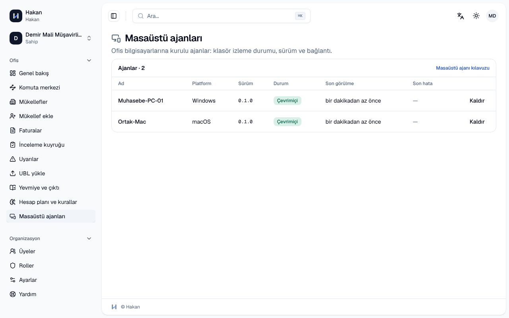

# Masaüstü ajanı kılavuzu

> Ofis bilgisayarına kurulan ajan: kurulum, klasör izleme, Logo / Mikro okuma ve sorun giderme.

Masaüstü ajanı ofis bilgisayarında arka planda çalışır. Bir klasöre düşen
e-fatura XML / ZIP dosyalarını seçtiğiniz mükellef adına otomatik yükler.
Dosyaları taşımaz ve silmez; aynı içerik bir kez yüklenir.

## Kurulum

1. Yöneticinizin verdiği kurulum dosyasını indirin: Windows için `.msi` /
   `.exe`, macOS için `.dmg`.
2. Kurun ve **Hakan masaüstü** uygulamasını açın.
   - İmzasız bir derlemede Windows "Windows kişisel bilgisayarınızı korudu"
     uyarısı gösterebilir: **Ek bilgi → Yine de çalıştır**.
   - macOS'ta ilk açılışta uygulamaya sağ tıklayıp **Aç**'ı seçin.
3. Uygulama ikinci kez açılmaz; açık pencereyi öne getirir.

## Kurulum: 3 adım

1. **HAKAN hesabınla gir:** ofis panelindeki e-posta ve parolanızla girin.
   İki adımlı doğrulama açıksa uygulama kodu ister. İlk açılışta
   **Sunucu adresi ▸** bölümüne yöneticinizin verdiği adresi yazın (ör.
   `https://hakan.ofisiniz.com`); **Bağlantıyı dene** ile denetleyebilirsiniz.
   Adres bir kez kaydedilir.
2. **Bu bilgisayarı tanıt:** ofisi seçin, bu bilgisayara ofiste görünecek
   bir ad verin (ör. `Ofis-PC`) ve **Kaydet**'e basın. Ajan ofise kaydolur.
3. **İlk klasörü bağla:** mükellefi adıyla seçin, e-Fatura XML / ZIP
   dosyalarının düştüğü klasörü seçin ya da pencereye sürükleyin ve
   **Bitir ve tepsiye geç**'e basın. İlk gönderim arka planda yapılır.
   **Şimdilik atla** ile bu adımı geçebilirsiniz.

Parolanız bilgisayarda saklanmaz. Oturum belirteci işletim sisteminin
anahtar zincirinde (Windows Kimlik Bilgisi Yöneticisi, macOS Anahtar
Zinciri) tutulur.

## Ana pencere

Soldaki menüde beş bölüm var: **Klasörler**, **Geçmiş**, **Sorunlar**,
**Muhasebe programı** ve **Ayarlar**. Sayılar menüde görünür (ör. Sorunlar
yanında kırmızı sayı). Menünün altındaki kart ajanın durumunu yazar:
**Bağlı**, **Sorun var**, **Bağlantı sorunu** ya da **Duraklatıldı**. Pencere
daraldığında menü ikon rayına, çok daraldığında üstte bir şeride dönüşür.

### Klasörler

1. **+ Klasör ekle**'ye basın.
2. **Mükellef**i adıyla arayıp seçin.
3. **Klasör seç…** ile klasörü işletim sisteminin penceresinden seçin (yol
   yazmanız gerekmez). Klasörü pencereye sürükleyip bırakabilirsiniz de.
4. İsterseniz kısa bir ad verin (ör. "Gelen e-faturalar") ve **İzlemeye
   al**'a basın.
5. Ajan klasörü 15 saniyede bir tarar. Boyutu ve zamanı iki taramada
   değişmeyen (yazılması bitmiş) `.xml` ve `.zip` dosyalarını gönderir.

Her satırda mükellefin adı, klasör yolu, son gönderim zamanı ve durum görünür:
**İzleniyor**, **N dosyada sorun**, **Klasör bulunamadı** ya da
**Duraklatıldı**. Satırın sonundaki **…** menüsünden **İzlemeden çıkar**
seçilebilir; klasördeki dosyalara dokunulmaz.

### Geçmiş

Gönderilen dosyalar mükellef adıyla, sonucu ve zamanıyla listelenir:
**Eklendi**, **Zaten var** (aynı dosya daha önce gönderilmiş),
**Yeniden denenecek** ya da gönderilmeme nedeni (ör. "UBL değil"). Liste bu
bilgisayarda tutulur (son 200 dosya); üstteki kutuyla dosya ya da mükellef
arayabilirsiniz.

### Sorunlar

- **Geçici** (ağ ya da sunucu): ajan bir sonraki taramada kendiliğinden
  yeniden dener; çubuk sonraki denemeye kalan süreyi gösterir.
- **Kalıcı** (ör. dosya e-fatura değil, klasör bulunamadı): sizin kararınızı
  bekler. Dosyayı düzeltin; listeden kaldırmak için **Yok say**'a basın.
  Taşınan klasörü **İzlemeden çıkar**ıp yeniden ekleyin.
- **Bilgi:** bugün "zaten var" olan dosyaların sayısı; işlem gerekmez.

### Bildirimler

Başarılı gönderimde bildirim gelmez. Bağlantı 30 dakika boyunca kurulamazsa
tek bir bildirim gelir ("Dosyalar bilgisayarda bekliyor, kaybolmaz").
Kalıcı hatalar için gün sonunda (18.00'den sonra) tek bir özet gelir.

## Ofis panelinden izleme

Ofisteki bütün ajanlar ofis panelinde **Masaüstü ajanları** sayfasında
listelenir: [ajanları aç](/t?to=agents). Sayfa her ajanın adını,
platformunu, sürümünü, **Çevrimiçi / Çevrimdışı** durumunu, son görülme
zamanını ve son hatasını gösterir.

- 30 dakika heartbeat göndermeyen ajan **Çevrimdışı** olur. Genel bakışta
  "masaüstü ajanı çevrimdışı" kartı çıkar ve ajanı kaydeden kullanıcıya
  bildirim gider.
- Artık kullanılmayan bir bilgisayarın ajanını **Kaldır** ile ofisten
  çıkarabilirsiniz (yazma izni gerekir). Kaldırılan ajan bir sonraki
  heartbeat'te reddedilir ve yükleme yapamaz.

## Arka planda çalışma

- Pencereyi kapatmak uygulamayı kapatmaz: pencere gizlenir, klasör izleme
  sürer. Sistem tepsisindeki simgeden pencereyi açarsınız.
- **Tepsi simgesi** durumu söyler (üç kristalli taç; macOS'ta menü
  çubuğunun rengine uyar):
  - **Bağlı**: her şey yolunda.
  - **Gönderiyor**: kristaller sırayla yanar; dosya gönderilirken.
  - **Duraklatıldı**: simge soluk.
  - **Sorun var**: kırmızı rozet (gönderilemeyen dosya, erişilemeyen
    klasör, sunucuya ulaşılamıyor, oturum açılmamış).
  - **Güncelleme hazır**: mavi rozet.
- Simgeye tıklamak pencereyi açar. Sağ tık (macOS'ta tık) **tepsi
  menüsünü** açar:
  - Üstte durum satırı ("Her şey yolunda" ya da sorunun kendisi), ofis ve
    bilgisayar adı.
  - Üç sayaç: **bugün gönderilen** dosya sayısı (uygulama açıkken
    sayılır), **izlenen klasör** sayısı ve **son tarama** zamanı.
  - Son gönderilen dosyalar (mükellef adıyla); tıklayınca **Geçmiş** açılır.
    Sorun varsa bunların yerine gönderilemeyen dosyalar ve nedenleri,
    **Şimdi yeniden dene** ve **Ayrıntılar** (**Sorunlar** sekmesi) çıkar.
  - **HAKAN'ı aç**, **Şimdi tara** (beklemeden klasörleri tarar),
    **İzlemeyi duraklat** (**30 dakika**, **2 saat** ya da **Ben sürdürene
    kadar**; duraklatılınca **İzlemeyi sürdür**), **Panelde aç** (web
    panelini tarayıcıda açar), **Ayarlar**.
  - **Oturum açılışında başlat**, sürüm satırı (yeni sürüm varsa
    **Güncelle ve yeniden başlat**) ve **Çıkış**.
- Süreli duraklatmada süre dolunca izleme kendiliğinden sürer; menüde
  "Kendiliğinden sürer: 11:12" gibi saati görürsünüz.
- **Oturum açılışında başlat** varsayılan olarak kapalıdır. Açarsanız
  bilgisayar açıldığında ajan pencere göstermeden başlar.
- Aynı ayarlar **Ayarlar** bölümünde de var: **Bilgisayar açılınca
  başlat** ve **Klasör izlemeyi duraklat**. İzleme duraklatılınca
  pencerenin üstünde bir uyarı ve **İzlemeyi sürdür** düğmesi görünür.
- **Ayarlar → Görünüm**'den renk paletini (**Kristal mavi** / **Yeşil**) ve
  **Açık / Koyu / Sistemi izle** seçimini yapabilirsiniz.

## Güncellemeler

- Uygulama açılışta ve 6 saatte bir yeni sürümü denetler. Yeni sürüm varsa
  pencerenin üstünde **Güncelle ve yeniden başlat** görünür; indirme
  ilerleme çubuğuyla izlenir, sonra uygulama yeniden açılır.
- **Ayarlar → Güncellemeler**'de kanalı seçebilirsiniz: **Kararlı** ya da
  **Beta (erken erişim)**. **Şimdi denetle** hemen denetler.
- "Bu derlemede otomatik güncelleme kapalı" yazıyorsa yöneticinizden yeni
  kurulum dosyasını isteyin.

## Logo / Mikro yerel okuma

Mükellefin Logo Tiger, Logo GO ya da Mikro veritabanına salt okunur bir SQL
kullanıcısıyla bağlanır. Yalnızca önceden tanımlı sorgular çalışır.

**Muhasebe programı** bölümünde önce programı seçin (**Logo Tiger**, **Logo GO**, **Mikro**), sonra:

- **Bağlantıyı dene:** bağlantıyı ve beklenen tabloları denetler; kaç
  tablonun bulunduğunu ve bulunamayanları yazar.
- **Geçen ayı önizle:** bir aylık faturaları okur; satış / alış sayısını ve
  ilk faturaları (belge no, tarih, karşı taraf, tutar) tablo olarak gösterir.

> Tablo ve alan adları pilot mükellefte doğrulanacak. Okunan veri şimdilik sunucuya gönderilmez.

## Sorun giderme

| Belirti | Ne yapmalı |
|---|---|
| Kurulum ekranı açılıyor | Oturum açın. Oturum sunucuda kapatıldıysa (ör. parola değişti) yeniden açın. |
| **Bu bilgisayarı tanıt** ekranı açılıyor | Ofisi seçip **Kaydet**'e basın. |
| Durum **Bağlantı sorunu** | İnternet bağlantısını ve sunucu adresini denetleyin. Ajan 30 dakika sessiz kalırsa ofis panelindeki [Masaüstü ajanları](/t?to=agents) sayfasında çevrimdışı görünür ve kaydeden kullanıcıya bildirim gider. |
| Durum **Yerel ajan yeniden başlatılıyor…** | Ajan kendini kısa aralıklarla (1, 2, 4… en çok 16 sn) yeniden başlatır. Düzelmezse **Ayarlar → Gelişmiş → Yerel ajanı yeniden başlat**. |
| Dosya gönderilmiyor | **Sorunlar** bölümüne bakın. Uzantı `.xml` ya da `.zip` mi? Dosya hâlâ yazılıyor olabilir: iki tarama bekleyin. İzleme duraklatılmış olabilir: **İzlemeyi sürdür**. |
| "Yeniden denenecek" | Ağ ya da sunucu sorunu. Ajan bir sonraki taramada yeniden dener. |
| Mükellef listede yok | Yalnızca size atanmış etkin mükellefler listelenir. Ofis yöneticinizden atama isteyin. |

**Ayarlar → Gelişmiş** destek içindir: uygulama ve yerel ajan sürümü, son
teknik hata, **Yerel ajanı dene** ve bir e-fatura XML dosyasını yerelde
denetleme (dosyayı pencereye sürükleyin; sunucuya gönderilmez).

**Günlük dosyası** (destek isterken ekleyin): `hakan.log`

| Sistem | Klasör |
|---|---|
| Windows | `%LOCALAPPDATA%\app.hakan.desktop\logs\` |
| macOS | `~/Library/Logs/app.hakan.desktop/` |
| Linux | `~/.local/share/app.hakan.desktop/logs/` |

Günlük dönerek tutulur (5 dosya × 2 MB). E-posta, VKN/TCKN, IBAN, telefon ve
belirteçler yazılmadan önce maskelenir.

Ajanı başka bir bilgisayara taşırken eski bilgisayarda **Oturumu kapat**'a
basın ya da ofis panelindeki [Masaüstü ajanları](/t?to=agents) sayfasından
eski kaydı kaldırın.
