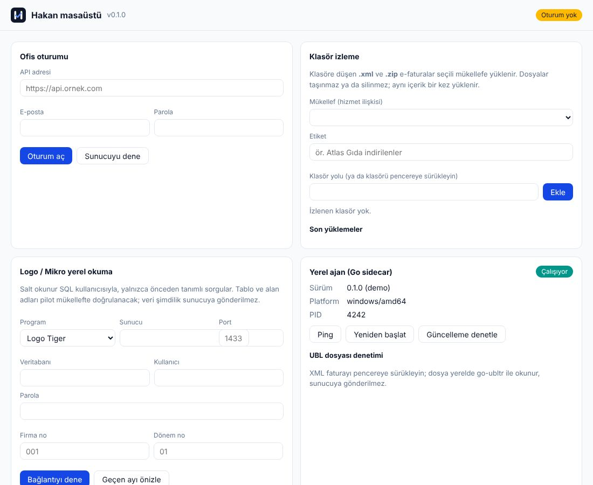

# Masaüstü ajanı kılavuzu

> Ofis bilgisayarına kurulan ajan: kurulum, klasör izleme, Logo / Mikro okuma ve sorun giderme.

Masaüstü ajanı ofis bilgisayarında arka planda çalışır. Bir klasöre düşen
e-fatura XML / ZIP dosyalarını seçtiğiniz mükellef adına otomatik yükler.
Dosyaları taşımaz ve silmez; aynı içerik bir kez yüklenir.

## Kurulum

1. Yöneticinizin verdiği kurulum dosyasını indirin: Windows için `.msi` /
   `.exe`, macOS için `.dmg`.
2. Kurun ve **Hakan masaüstü** uygulamasını açın.
   - İmzasız bir derlemede Windows "Windows kişisel bilgisayarınızı korudu"
     uyarısı gösterebilir: **Ek bilgi → Yine de çalıştır**.
   - macOS'ta ilk açılışta uygulamaya sağ tıklayıp **Aç**'ı seçin.
3. Uygulama ikinci kez açılmaz; açık pencereyi öne getirir.

## Oturum açma ve ofis seçimi

1. **API adresi**ni yazın (yöneticinizden alın, ör.
   `https://api.ofisiniz.com`) ve **Sunucuyu dene** ile denetleyin.
2. Ofis panelindeki e-posta ve parolanızla oturum açın. İki adımlı
   doğrulama açıksa kodu da girin.
3. Ofisi seçin, bu bilgisayar için bir **ajan adı** verin (ör.
   `Muhasebe-PC-01`) ve **Ajanı başlat**'a basın. Ajan ofise kaydolur;
   rozet **Çevrimiçi** olur.

Parolanız bilgisayarda saklanmaz. Oturum belirteci işletim sisteminin
anahtar zincirinde (Windows Kimlik Bilgisi Yöneticisi, macOS Anahtar
Zinciri) tutulur.

## Klasör izleme

1. **Mükellef**i seçin ve isterseniz bir **etiket** yazın (ör. "Atlas Gıda
   indirilenler").
2. **Klasör yolu**nu yazın ya da klasörü pencereye sürükleyin ve **Ekle**'ye
   basın.
3. Ajan klasörü 15 saniyede bir tarar. Boyutu ve zamanı iki taramada
   değişmeyen (yazılması bitmiş) `.xml` ve `.zip` dosyalarını yükler.
4. **Son yüklemeler** her dosyanın sonucunu gösterir:
   - **yüklendi:** faturalar ofis panelinde görünür.
   - **reddedildi:** dosya geçerli bir UBL değil ya da çok büyük; yeniden
     denenmez. Dosyayı kontrol edin.
   - **gönderilemedi, yeniden denenecek:** ağ ya da sunucu sorunu; bir
     sonraki taramada yeniden denenir.

Bir klasörü izlemeden çıkarmak için satırındaki **Kaldır**'a basın.

## Arka planda çalışma

- Pencereyi kapatmak uygulamayı kapatmaz: pencere gizlenir, klasör izleme
  sürer. Sistem tepsisindeki simgeden pencereyi açarsınız.
- Tepsi menüsü: **Aç**, **İzlemeyi duraklat / sürdür**, **Oturum açılışında
  başlat**, **Çıkış**.
- **Oturum açılışında başlat** varsayılan olarak kapalıdır. Açarsanız
  bilgisayar açıldığında ajan pencere göstermeden başlar.

## Logo / Mikro yerel okuma

Mükellefin Logo Tiger, Logo GO ya da Mikro veritabanına salt okunur bir SQL
kullanıcısıyla bağlanır. Yalnızca önceden tanımlı sorgular çalışır.

- **Bağlantıyı dene:** bağlantıyı ve beklenen tabloları denetler.
- **Geçen ayı önizle:** bir aylık veriyi okuyup özetler.

> Tablo ve alan adları pilot mükellefte doğrulanacak. Okunan veri şimdilik sunucuya gönderilmez.

## Sorun giderme

| Belirti | Ne yapmalı |
|---|---|
| Rozet **Oturum yok** | Oturum açın. Oturum sunucuda kapatıldıysa (ör. parola değişti) yeniden açın. |
| Rozet **Ofis seçilmedi** | Ofisi seçip **Ajanı başlat**'a basın. |
| Rozet **Bağlantı sorunu** | İnternet bağlantısını ve API adresini denetleyin. Ajan 30 dakika sessiz kalırsa ofis panelinde çevrimdışı görünür ve kaydeden kullanıcıya bildirim gider. |
| Yerel ajan **Kapandı** | Ajan kendini kısa aralıklarla (1, 2, 4… en çok 16 sn) yeniden başlatır. Düzelmezse **Yeniden başlat**'a basın. |
| Dosya yüklenmiyor | Uzantı `.xml` ya da `.zip` mi? Dosya hâlâ yazılıyor olabilir: iki tarama bekleyin. İzleme duraklatılmış olabilir: tepsiden **İzlemeyi sürdür**. |
| "Çok fazla yükleme" | Kısa sürede çok sayıda dosya gönderildi. Ajan bir sonraki taramada yeniden dener. |
| Güncelleme | **Güncelleme denetle**. Bu derlemede güncelleyici kapalıysa yöneticinizden yeni kurulum dosyasını isteyin. |

**Günlük dosyası** (destek isterken ekleyin): `hakan.log`

| Sistem | Klasör |
|---|---|
| Windows | `%LOCALAPPDATA%\app.hakan.desktop\logs\` |
| macOS | `~/Library/Logs/app.hakan.desktop/` |
| Linux | `~/.local/share/app.hakan.desktop/logs/` |

Günlük dönerek tutulur (5 dosya × 2 MB). E-posta, VKN/TCKN, IBAN, telefon ve
belirteçler yazılmadan önce maskelenir.

Ajanı başka bir bilgisayara taşırken eski bilgisayarda **Oturumu kapat**'a
basın.
