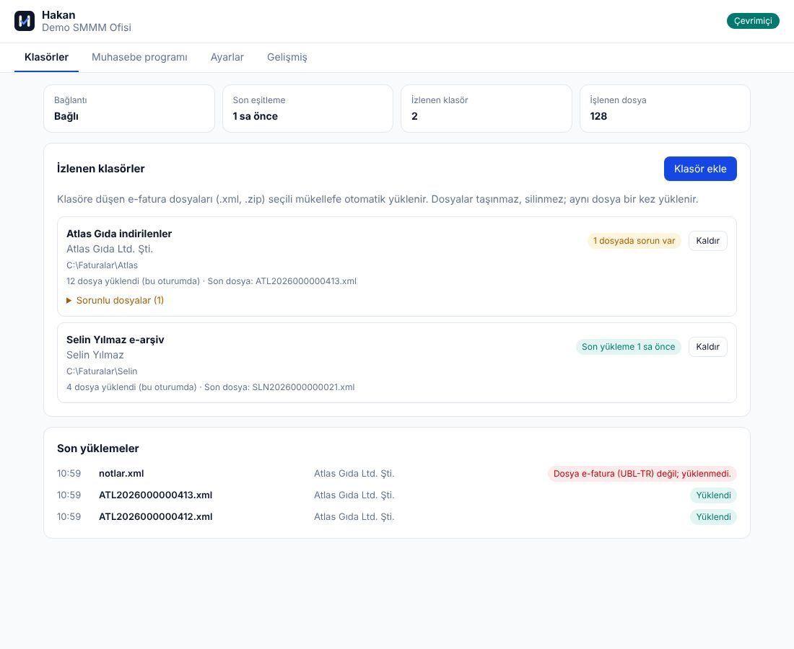

# Masaüstü ajanı kılavuzu

> Ofis bilgisayarına kurulan ajan: kurulum, klasör izleme, Logo / Mikro okuma ve sorun giderme.

Masaüstü ajanı ofis bilgisayarında arka planda çalışır. Bir klasöre düşen
e-fatura XML / ZIP dosyalarını seçtiğiniz mükellef adına otomatik yükler.
Dosyaları taşımaz ve silmez; aynı içerik bir kez yüklenir.

## Kurulum

1. Yöneticinizin verdiği kurulum dosyasını indirin: Windows için `.msi` /
   `.exe`, macOS için `.dmg`.
2. Kurun ve **Hakan masaüstü** uygulamasını açın.
   - İmzasız bir derlemede Windows "Windows kişisel bilgisayarınızı korudu"
     uyarısı gösterebilir: **Ek bilgi → Yine de çalıştır**.
   - macOS'ta ilk açılışta uygulamaya sağ tıklayıp **Aç**'ı seçin.
3. Uygulama ikinci kez açılmaz; açık pencereyi öne getirir.

## Oturum açma ve ofis seçimi

1. Ofis panelindeki e-posta ve parolanızla oturum açın. İki adımlı
   doğrulama açıksa uygulama kodu ister.
2. İlk açılışta **Sunucu adresi** bölümüne yöneticinizin verdiği adresi
   yazın (ör. `https://hakan.ofisiniz.com`). **Bağlantıyı dene** ile
   denetleyebilirsiniz. Adres bir kez kaydedilir.
3. Ofisi seçin, bu bilgisayara ofiste görünecek bir ad verin (ör.
   `Muhasebe masası`) ve **Devam et**'e basın. Ajan ofise kaydolur; sağ
   üstteki rozet **Çevrimiçi** olur.

Parolanız bilgisayarda saklanmaz. Oturum belirteci işletim sisteminin
anahtar zincirinde (Windows Kimlik Bilgisi Yöneticisi, macOS Anahtar
Zinciri) tutulur.

## Klasör izleme

1. **Klasörler** sekmesinde **Klasör ekle**'ye basın.
2. **Mükellef**i adıyla arayıp seçin.
3. **Klasör seç…** ile klasörü işletim sisteminin penceresinden seçin (yol
   yazmanız gerekmez). Klasörü uygulama penceresine sürükleyip
   bırakabilirsiniz de.
4. İsterseniz kısa bir ad verin (ör. "Gelen e-faturalar") ve **İzlemeye
   al**'a basın.
5. Ajan klasörü 15 saniyede bir tarar. Boyutu ve zamanı iki taramada
   değişmeyen (yazılması bitmiş) `.xml` ve `.zip` dosyalarını yükler.

Her klasörün kartında mükellefin adı, son yükleme zamanı ve durum görünür:

- **Son yükleme …:** dosyalar sorunsuz yükleniyor.
- **N dosyada sorun var:** **Sorunlu dosyalar** listesini açın. Her
  dosyanın adı ve nedeni yazar (ör. "Dosya e-fatura (UBL-TR) değil").
  Dosyayı düzelttikten sonra **Listeyi temizle**'ye basabilirsiniz.
- **Klasör bulunamadı:** klasör taşınmış ya da silinmiş; klasörü kaldırıp
  yeniden ekleyin.

**Son yüklemeler** bu oturumdaki dosyaları mükellef adıyla gösterir:

- **Yüklendi:** faturalar ofis panelinde görünür.
- **Yüklenmedi** (nedeniyle): dosya geçerli bir e-fatura değil ya da çok
  büyük; yeniden denenmez.
- **Gönderilemedi, yeniden denenecek:** ağ ya da sunucu sorunu; bir sonraki
  taramada yeniden denenir.

Bir klasörü izlemeden çıkarmak için kartındaki **Kaldır**'a basın.
Klasördeki dosyalara dokunulmaz.

## Arka planda çalışma

- Pencereyi kapatmak uygulamayı kapatmaz: pencere gizlenir, klasör izleme
  sürer. Sistem tepsisindeki simgeden pencereyi açarsınız.
- Tepsi menüsü: **Aç**, **İzlemeyi duraklat / sürdür**, **Oturum açılışında
  başlat**, **Çıkış**.
- **Oturum açılışında başlat** varsayılan olarak kapalıdır. Açarsanız
  bilgisayar açıldığında ajan pencere göstermeden başlar.
- Aynı ayarlar **Ayarlar** sekmesinde de var: **Bilgisayar açılınca
  Hakan'ı başlat** ve **Klasör izlemeyi duraklat**. İzleme duraklatılınca
  pencerenin üstünde bir uyarı ve **İzlemeyi sürdür** düğmesi görünür.

## Güncellemeler

- Uygulama açılışta ve 6 saatte bir yeni sürümü denetler. Yeni sürüm varsa
  pencerenin üstünde **Güncelle ve yeniden başlat** görünür; indirme
  ilerleme çubuğuyla izlenir, sonra uygulama yeniden açılır.
- **Ayarlar → Güncellemeler**'de kanalı seçebilirsiniz: **Kararlı** ya da
  **Beta (erken erişim)**. **Şimdi denetle** hemen denetler.
- "Bu derlemede otomatik güncelleme kapalı" yazıyorsa yöneticinizden yeni
  kurulum dosyasını isteyin.

## Logo / Mikro yerel okuma

Mükellefin Logo Tiger, Logo GO ya da Mikro veritabanına salt okunur bir SQL
kullanıcısıyla bağlanır. Yalnızca önceden tanımlı sorgular çalışır.

**Muhasebe programı** sekmesinde:

- **Bağlantıyı dene:** bağlantıyı ve beklenen tabloları denetler; kaç
  tablonun bulunduğunu ve bulunamayanları yazar.
- **Geçen ayı önizle:** bir aylık faturaları okur; satış / alış sayısını ve
  ilk faturaları (belge no, tarih, karşı taraf, tutar) tablo olarak gösterir.

> Tablo ve alan adları pilot mükellefte doğrulanacak. Okunan veri şimdilik sunucuya gönderilmez.

## Sorun giderme

| Belirti | Ne yapmalı |
|---|---|
| Rozet **Oturum açılmadı** | Oturum açın. Oturum sunucuda kapatıldıysa (ör. parola değişti) yeniden açın. |
| Rozet **Ofis seçilmedi** | Ofisi seçip **Devam et**'e basın. |
| Rozet **Bağlantı sorunu** | İnternet bağlantısını ve sunucu adresini denetleyin. Ajan 30 dakika sessiz kalırsa ofis panelinde çevrimdışı görünür ve kaydeden kullanıcıya bildirim gider. |
| Rozet **Yerel ajan yeniden başlatılıyor…** | Ajan kendini kısa aralıklarla (1, 2, 4… en çok 16 sn) yeniden başlatır. Düzelmezse **Gelişmiş → Yerel ajanı yeniden başlat**. |
| Dosya yüklenmiyor | Klasörün **Sorunlu dosyalar** listesine bakın. Uzantı `.xml` ya da `.zip` mi? Dosya hâlâ yazılıyor olabilir: iki tarama bekleyin. İzleme duraklatılmış olabilir: **İzlemeyi sürdür**. |
| "Gönderilemedi, yeniden denenecek" | Ağ ya da sunucu sorunu. Ajan bir sonraki taramada yeniden dener. |
| Mükellef listede yok | Yalnızca size atanmış etkin mükellefler listelenir. Ofis yöneticinizden atama isteyin. |

**Gelişmiş** sekmesi destek içindir: uygulama ve yerel ajan sürümü, son
teknik hata, **Yerel ajanı dene** ve bir e-fatura XML dosyasını yerelde
denetleme (dosyayı pencereye sürükleyin; sunucuya gönderilmez).

**Günlük dosyası** (destek isterken ekleyin): `hakan.log`

| Sistem | Klasör |
|---|---|
| Windows | `%LOCALAPPDATA%\app.hakan.desktop\logs\` |
| macOS | `~/Library/Logs/app.hakan.desktop/` |
| Linux | `~/.local/share/app.hakan.desktop/logs/` |

Günlük dönerek tutulur (5 dosya × 2 MB). E-posta, VKN/TCKN, IBAN, telefon ve
belirteçler yazılmadan önce maskelenir.

Ajanı başka bir bilgisayara taşırken eski bilgisayarda **Oturumu kapat**'a
basın.
