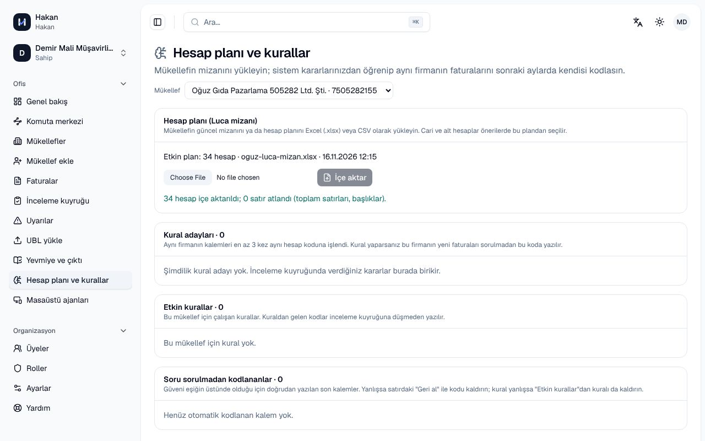

# Mizan hafızası nasıl çalışır

> Mükellefin mizanını bir kez yükleyin; sistem kararlarınızdan öğrenir ve aynı firmanın faturalarını sonraki aylarda sizin yerinize doğru hesaba yazar.

Her mükellefin hesap planı farklıdır. Bir mükellefte Korkmaz Gıda
`120.01.006` hesabında, başka bir mükellefte `120.03.014` hesabında durur.
Mizan hafızası bu farkı mükellef bazında hatırlar:

1. **Mizanı yüklersiniz.** Sistem cari ve alt hesapları tanır.
2. **İlk ay öneri yapar.** Faturadaki firmayı mizanda bulur; bulamazsa
   açılması gereken yeni cari kodu önerir.
3. **Siz düzeltirsiniz.** Kararlarınız kaydedilir.
4. **Aynı karar tekrar ederse kural önerir.** Bir tıkla kural yaparsınız.
5. **Sonraki aylarda soru sormaz.** Aynı firmanın kalemleri kuraldaki koda
   kendiliğinden yazılır; inceleme kuyruğunuza düşmez.

Ekran: kenar çubuğunda **Hesap planı ve kurallar**.

## 1. Mizanı yükleyin

Luca'da mükellefin mizanını (ya da hesap planını) **Excel (.xlsx)** veya
**CSV** olarak dışa alın. **Hesap planı ve kurallar** sayfasında mükellefi
seçin, dosyayı seçip **İçe aktar**'a basın.

- Başlık satırı ("Hesap Kodu", "Hesap Adı", "Borç", "Alacak", bakiye
  sütunları) kendiliğinden bulunur; üstteki şirket adı ve tarih satırları,
  toplam satırları atlanır.
- `320 01 005`, `320-01-005` gibi yazımlar `320.01.005` olarak okunur.
- Eski **.xls** biçimi okunmaz; Luca'dan .xlsx ya da CSV alın.
- Yeni mizan yüklediğinizde etkin plan onunla değişir (eskiler geçmişte
  durur). Ay sonunda güncel mizanı yüklemeniz yeterli.

## 2. İlk ay: öneriler mizandan gelir

Faturaları yükledikten sonra fatura ekranında **Hesap kodu öner**'e basın.
Öneriler **İnceleme kuyruğu**na düşer.

- **Cari hesap:** Satıştaki müşteri 120, alıştaki satıcı 320 altında
  **unvanla** aranır. Büyük/küçük harf, nokta ve boşluk farkı önemsenmez
  ("KORKMAZ GIDA SAN. VE TİC. A.Ş." = "Korkmaz Gıda San. ve Tic. A.Ş.").
  - Mizanda varsa o hesap önerilir (örnek: Korkmaz Gıda → `120.01.006`).
  - Yoksa **sıradaki boş kod** önerilir ve "açılmalı" diye işaretlenir
    (örnek: 320.01.001–006 doluysa Yeni Lojistik → `320.01.007`). Bu cari
    hesabı Luca'da da açmanız gerekir.
- **Kalem hesabı:** Firmayla daha önce verdiğiniz karar yoksa genel kural
  önerilir (alış → 153, satış → 600). Bunlar düşük güvenli olduğu için
  kuyrukta onayınızı bekler.
- **KDV hesabı:** KDV'li kalemler için 191 / 391 önerilir.

Kuyrukta önerinin altında **neden** önerildiği yazar (hangi kural, hangi
geçmiş karar).

## 3. Düzeltin: sistem öğrenir

Öneri yanlışsa satırdaki **Kodu değiştir** ile doğru kodu yazıp Enter'a
basın. Örnek: Deniz Ambalaj'dan alınan koli, streç film ve etiket ticari mal
değil, ambalaj malzemesidir; `153` yerine `150.01` yazarsınız.

Her düzeltme ve onay, **firma (VKN) + alış/satış + hesap kodu** olarak
kaydedilir.

## 4. Kural adayı: "Kural yapılsın mı?"

Aynı firmanın kalemleri **en az 3 kez** aynı hesap koduna işlendiğinde
**Hesap planı ve kurallar** sayfasındaki **Kural adayları** listesinde
görünür.

**Kural yap**'a bastığınızda kural yalnızca **bu mükellef** için oluşur ve
**Etkin kurallar** listesine geçer. Kaynağı "Kararlarınızdan" diye yazar.

## 5. Sonraki aylar: soru sorulmadan

Kuraldaki firmanın yeni faturalarında **Hesap kodu öner** dediğinizde
kalemler doğrudan kuraldaki koda yazılır. Güveni onay eşiğinin (%95)
üstünde olduğu için inceleme kuyruğuna düşmezler; **Soru sorulmadan
kodlananlar** listesinde "Kural" etiketiyle görünürler.

Yanlış giden bir kalem olursa satırındaki **Geri al** ile kodu kaldırın;
doğru kodu faturada yeniden **Hesap kodu öner** deyip kuyruktan verin. Kural
artık doğru değilse (firmadan farklı türde mal almaya başladıysanız) **Etkin
kurallar** listesinde **Kuralı kaldır**'a basın: o firmanın yeni kalemleri
yeniden kuyruğa düşer, önceden yazılan kodlar değişmez.

## 6. Luca'ya aktarırken denetim

**Yevmiye ve çıktı** ekranında Luca dosyası alırken fişteki her hesap
kodu yüklediğiniz mizanda aranır. Mizanda olmayan bir kod varsa (örneğin
henüz açmadığınız `320.01.007`) çıktı **durdurulur** ve "Hesap kodu hedef
hesap planında yok" yazar. Hesabı Luca'da açın, güncel mizanı yeniden yükleyin
ve çıktıyı tekrar alın.

## Sık sorulanlar

- **Kural ne zaman yanlış olur?** Aynı firmadan farklı türde mal aldığınız
  durumlarda (ör. hem ambalaj hem ticari mal). O firmanın kuralını
  yapmayın; yaptıysanız **Kuralı kaldır** ile kaldırın.
- **Firma mizanda var ama yeni hesap önerdi.** Unvan mizanda farklı yazılmış
  olabilir (ör. "Sanayi" ↔ "San."). Öneriyi mizandaki koda düzeltin; o
  firmanın bundan sonraki faturaları için geçmiş kararınız kullanılır.
- **Eşik nedir?** Bir öneri %95 ve üstü güvenliyse sizin onayınızı
  beklemeden yazılır. Ofis ve mükellef bazında değiştirilebilir.
