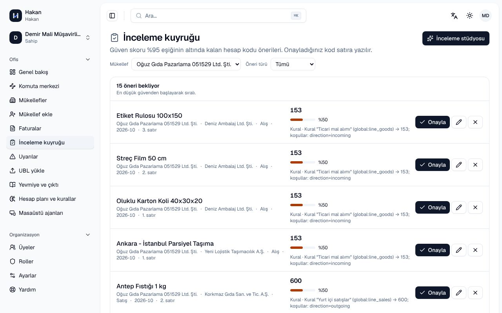
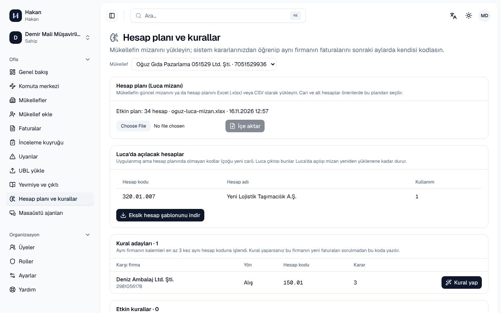
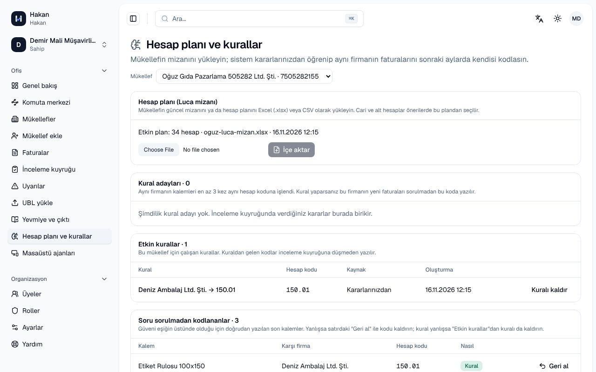

# Mizan hafızası nasıl çalışır

> Mükellefin mizanını bir kez yükleyin; sistem kararlarınızdan öğrenir ve aynı firmanın faturalarını sonraki aylarda sizin yerinize doğru hesaba yazar.

Her mükellefin hesap planı farklıdır. Bir mükellefte Korkmaz Gıda
`120.01.006` hesabında, başka bir mükellefte `120.03.014` hesabında durur.
Mizan hafızası bu farkı mükellef bazında hatırlar:

1. **Mizanı yüklersiniz.** Sistem cari ve alt hesapları tanır.
2. **Faturaları yüklediğiniz anda öneri yapar.** Faturadaki firmayı
   mizanda bulur; bulamazsa açılması gereken yeni cari kodu önerir.
3. **Siz düzeltirsiniz.** Kararlarınız kaydedilir; onayladığınız cari
   firmanın VKN'siyle hatırlanır.
4. **Aynı karar tekrar ederse kural önerir.** Bir tıkla kural yaparsınız.
5. **Sonraki aylarda soru sormaz.** Faturaları yüklemeniz yeter: aynı
   firmanın kalemleri kuraldaki koda kendiliğinden yazılır; inceleme
   kuyruğunuza düşmez.

Ekran: kenar çubuğunda **Mizan hafızası**.

## 1. Mizanı yükleyin

Luca'da mükellefin mizanını (ya da hesap planını) **Excel (.xlsx)** veya
**CSV** olarak dışa alın. **Mizan hafızası** sayfasında mükellefi
seçin, dosyayı seçip **İçe aktar**'a basın.

- Başlık satırı ("Hesap Kodu", "Hesap Adı", "Borç", "Alacak", bakiye
  sütunları) kendiliğinden bulunur; üstteki şirket adı ve tarih satırları,
  toplam satırları atlanır.
- `320 01 005`, `320-01-005` gibi yazımlar `320.01.005` olarak okunur.
- Eski **.xls** biçimi okunmaz; Luca'dan .xlsx ya da CSV alın.
- Yeni mizan yüklediğinizde etkin plan onunla değişir (eskiler geçmişte
  durur). Ay sonunda güncel mizanı yüklemeniz yeterli.

## 2. İlk ay: öneriler mizandan gelir

Faturaları (UBL / ZIP) yüklediğinizde, mizanı ya da kuralı olan mükellefte
hesap kodu önerileri **kendiliğinden** hazırlanır; bir şeye basmanız
gerekmez. Birkaç saniye sonra öneriler **İnceleme kuyruğu**na düşer.
Fatura ekranındaki **Hesap kodu öner** düğmesi, öneriyi elle yeniden
hazırlatmak için durur (ör. mizanı faturalardan sonra yüklediyseniz).

Mizanı ve kuralı olmayan mükellefte öneri kendiliğinden hazırlanmaz;
**Hesap kodu öner** ile elle isteyebilirsiniz.

- **Cari hesap:** Satıştaki müşteri 120, alıştaki satıcı 320 altında
  aranır. Önce **VKN** ile: bu firmanın carisini daha önce onayladıysanız ya
  da düzelttiyseniz o hesap sorulmadan yazılır. Yoksa **unvanla** aranır.
  Unvanda büyük/küçük harf, nokta, boşluk ve Türkçe harf farkı önemsenmez;
  yaygın kısaltmalar açık hâliyle aynı sayılır:
  "San." = "Sanayi", "Tic." = "Ticaret", "Ltd. Şti." = "Limited Şirketi",
  "A.Ş." = "Anonim Şirketi", "İnş." = "İnşaat", "Paz." = "Pazarlama"
  ("KORKMAZ GIDA SAN. VE TİC. A.Ş." = "Korkmaz Gıda Sanayi ve Ticaret
  Anonim Şirketi").
  - Mizanda varsa o hesap önerilir (örnek: Korkmaz Gıda → `120.01.006`).
  - Yoksa **sıradaki boş kod** önerilir ve "açılmalı" diye işaretlenir
    (örnek: 320.01.001–006 doluysa Yeni Lojistik → `320.01.007`). Bu cari
    hesabı Luca'da da açmanız gerekir.
- **Kalem hesabı:** Firmayla daha önce verdiğiniz karar yoksa genel kural
  önerilir (alış → 153, satış → 600). Bunlar düşük güvenli olduğu için
  kuyrukta onayınızı bekler.
- **KDV hesabı:** KDV'li kalemler için 191 / 391 önerilir. Mizanda oranlı
  alt hesaplar varsa kalemin oranına göre alt hesaba gider: adında "%20"
  geçen `191.01`, "%10" geçen `191.02` gibi. Oran adda yazmıyorsa ya da aynı
  oranda birden çok alt hesap varsa ana hesapta (191 / 391) kalır.

Kuyrukta önerinin altında **neden** önerildiği yazar (hangi kural, hangi
geçmiş karar).

## 3. Düzeltin: sistem öğrenir

Öneri yanlışsa satırdaki **Kodu değiştir** ile doğru kodu yazıp Enter'a
basın. Örnek: Deniz Ambalaj'dan alınan koli, streç film ve etiket ticari mal
değil, ambalaj malzemesidir; `153` yerine `150.01` yazarsınız.

Her düzeltme ve onay, **firma (VKN) + alış/satış + hesap kodu** olarak
kaydedilir. Cari için verdiğiniz karar (onay ya da düzeltme) ayrıca
**VKN → cari hesap** olarak hatırlanır: unvan mizanda farklı yazılmış olsa
bile o firmanın sonraki faturaları aynı cariye gider. Kararı **Geri al**
derseniz bu eşleme de unutulur.

### "Açılmalı" cariler: Luca'da açılacak hesaplar

Yeni bir cariyi onayladığınızda hesap henüz Luca'da yoktur. Sayfadaki
**Luca'da açılacak hesaplar** listesi, uygulanmış ama mizanda olmayan
kodları gösterir. **Eksik hesap şablonunu indir** ile bu hesapları Excel
olarak alın, Luca'ya aktarın (ya da elle açın), sonra güncel mizanı yeniden
yükleyin: hesap listeden düşer.

 Şablonun sütun düzeni Luca'nın kendi
şablonuyla henüz doğrulanmadı; dosyadaki "Bilgi" sayfası bunu belirtir.

## 4. Kural adayı: "Kural yapılsın mı?"

Aynı firmanın kalemleri **en az 3 kez** aynı hesap koduna işlendiğinde
**Mizan hafızası** sayfasındaki **Kural adayları** listesinde
görünür. Bu sayı (2–10) ve hangi kararların sayılacağı (yalnızca
düzeltmeler ya da düzeltmeler ve onaylar) **Ayarlar → Yapay zekâ ve onay**
bölümünden değiştirilir; değiştirmeden önce bugünkü ve yeni ayarla kaç aday
çıkacağı gösterilir.

**Kural yap**'a bastığınızda kural yalnızca **bu mükellef** için oluşur ve
**Etkin kurallar** listesine geçer. Kaynağı "Kararlarınızdan" diye yazar.

### Elle kural yazmak

**Etkin kurallar** panelindeki **+ Yeni kural** sağda kural editörünü açar.
Koşulları (karşı taraf VKN'si, adında geçen metin, satır metninde geçen
kelimeler, yön, KDV oranı) ve hesap kodunu yazın. Kaydetmeden önce
**Kaydetmeden önce · son 6 ay** kutusu kuralın kaç belgeye uyduğunu, kaçının
zaten bu kodla, kaçının başka bir kodla onaylandığını ve örnek faturaları
gösterir. Başka kodla onaylananlar kırmızıdır: kuralı daraltmak için
koşul ekleyin. Kural yalnızca seçili mükellef için kaydedilir.

## 5. Sonraki aylar: soru sorulmadan

Kuraldaki firmanın yeni faturalarını yüklediğinizde kalemler doğrudan
kuraldaki koda yazılır; **Hesap kodu öner**'e basmanız gerekmez. Güveni
onay eşiğinin (%95) üstünde olduğu için inceleme kuyruğuna düşmezler;
**Soru sorulmadan kodlananlar** listesinde "Kural" etiketiyle görünürler.
VKN ile hatırlanan cariler de aynı şekilde sorulmadan yazılır.

**Hangi kural kazanır?** Önce bu mükellef için yaptığınız kurallar, sonra
ofis şablonundan gelen kurallar, en son genel varsayılanlar (153, 600, 191,
391…). Ofis şablonundaki bir kuralın öncelik numarası daha küçük olsa bile
mükellefe yaptığınız kural önce gelir.

Yanlış giden bir kalem olursa satırındaki **Geri al** ile kodu kaldırın;
doğru kodu faturada yeniden **Hesap kodu öner** deyip kuyruktan verin. Kural
artık doğru değilse (firmadan farklı türde mal almaya başladıysanız) **Etkin
kurallar** listesinde **Kuralı kaldır**'a basın: o firmanın yeni kalemleri
yeniden kuyruğa düşer, önceden yazılan kodlar değişmez.

## 6. Luca'ya aktarırken denetim

**Yevmiye ve çıktı** ekranında Luca dosyası alırken fişteki her hesap
kodu yüklediğiniz mizanda aranır:

- `320 01 002` gibi yazımlar `320.01.002` olarak okunur ve dosyaya bu
  biçimde yazılır.
- Mizanda olmayan bir kod varsa (örneğin henüz açmadığınız `320.01.007`)
  çıktı **durdurulur** ve "Hesap kodu hedef hesap planında yok" yazar.
- Alt hesabı olan bir **ana hesap** (örneğin `153.01` varken `153`) da
  durdurulur: Luca ana hesaba fiş almaz. Fişi alt hesapla düzeltin.

Hesabı Luca'da açın, güncel mizanı yeniden yükleyin ve çıktıyı tekrar alın.
Durum aynı zamanda **Uyarılar** ekranına "Hesap kodu hedef hesap planında
yok" uyarısı olarak düşer; kod düzelince uyarı kendiliğinden kapanır.

"Faturalar Luca'ya doğrudan gidiyor" ayarı açıksa faturadan gelen fişler
(kalem kalem işlenenler dahil) çifte kayıt olmasın diye çıktıya girmez.

## Sık sorulanlar

- **Kural ne zaman yanlış olur?** Aynı firmadan farklı türde mal aldığınız
  durumlarda (ör. hem ambalaj hem ticari mal). O firmanın kuralını
  yapmayın; yaptıysanız **Kuralı kaldır** ile kaldırın.
- **Firma mizanda var ama yeni hesap önerdi.** Unvan mizanda başka
  kelimelerle yazılmış olabilir (kısaltmalar zaten eşleşir; "Gıda" ↔
  "Gıda Ürünleri" gibi farklar eşleşmez). Öneriyi mizandaki koda düzeltin;
  karar VKN ile hatırlanır, o firmanın bundan sonraki faturaları o cariye
  gider.
- **Eşik nedir?** Bir öneri %95 ve üstü güvenliyse sizin onayınızı
  beklemeden yazılır. Ofis ve mükellef bazında değiştirilebilir.
