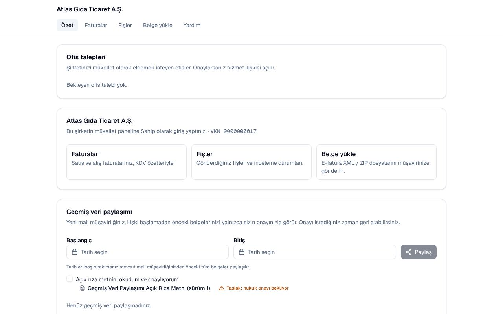
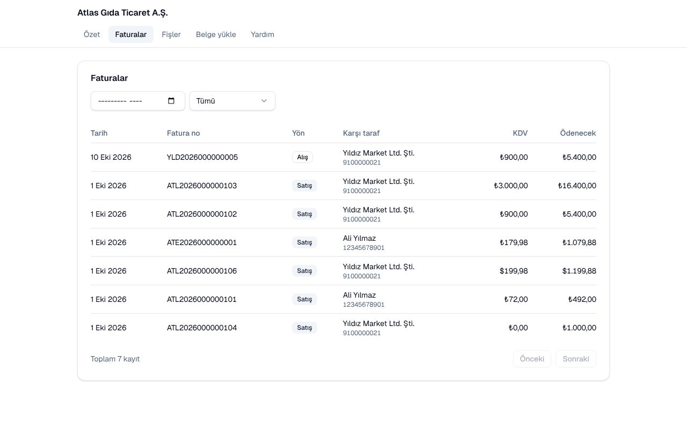
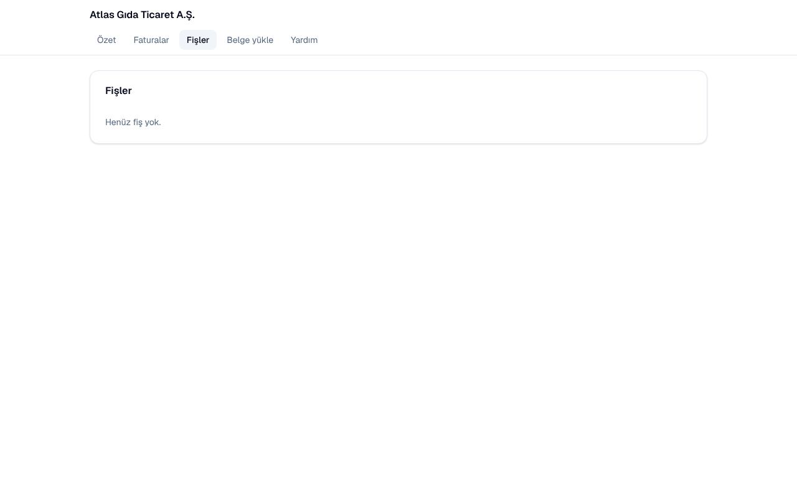
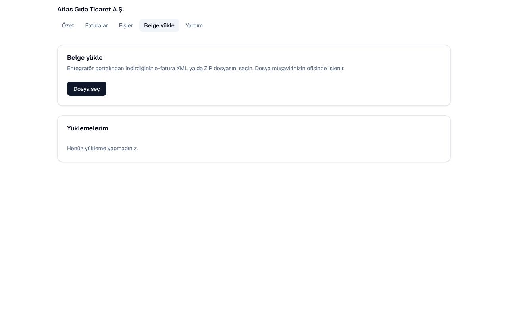

# Mükellef kılavuzu

> Mobil uygulama ve web paneli: fiş gönderme, belge yükleme, görevler ve faturalarınız.

Müşavirliğiniz sizi panele davet eder. Davet e-postasındaki bağlantıyla
hesabınızı açın; aynı e-posta ve şifreyle hem web paneline hem mobil
uygulamaya girersiniz.

## Ofis talebini onaylama

Bir mali müşavir ofisi şirketinizi mükellef olarak eklemek istediğinde size bir
onay bağlantısı gelir. Bağlantıda ofisin adı ve şirketiniz yazar.

- **Onayla:** hizmet ilişkisi açılır ve ofis şirketinizin mali kayıtlarına
  erişir. Başka bir ofisle çalışıyorsanız o ilişki sona erer.
- **Reddet:** ofis talebin reddedildiğini görür.

Şirketinizde birden çok yetkili varsa onayınız onlara da iletilir; onlar da
panelden onaylayabilir.

## Web paneli

Girişten sonra şirketinizin paneli açılır. Birden çok şirketiniz varsa önce
şirket seçersiniz. Üst menüde **Özet**, **Faturalar**, **Fişler**,
**Belge yükle** ve **Yardım** bulunur.

**Özet** sayfasında **Bu ayın KDV durumu** kartı da bulunur: kestiğiniz ve
size gelen faturalardan hesaplanan satış KDV'si, alış KDV'si, önceki aydan
devreden KDV, ödenecek (ya da sonraki aya devredecek) KDV tahmini ve son
ödeme günü. Altındaki **Satış raporu** bu ayki satış toplamınızı (iadeler
düşülmüş, KDV hariç), en çok satış yaptığınız alıcıları ve son altı ayın
satışını gösterir; sağ üstten önceki bir ayı seçebilirsiniz. Rakamlar
tahmindir, kesin tutarı müşaviriniz beyanla belirler. Müşaviriniz bu
bölümü kapattıysa görünmez.

### Faturalar

Satış ve alış faturalarınız KDV özetleriyle listelenir. Faturaya tıklayınca
ayrıntısı açılır.

### Fişler

Mobil uygulamadan gönderdiğiniz fişler ve inceleme durumları burada görünür.
Müşaviriniz bir fişte düzeltme isterse fişin durumunda yazar.

### Belge yükle

e-Fatura XML ya da ZIP dosyalarını müşavirinize buradan gönderirsiniz.
Dosyayı seçin ve yükleyin; **Yüklemelerim** listesinde sonucunu görürsünüz.
Aynı fatura ikinci kez eklenmez.

#### Yabancı hizmet faturası gönder

Google Ads, Meta, AWS, yurt dışı yazılım lisansı gibi yurt dışından
aldığınız hizmetlerin faturalarını **Belge yükle** sayfasının üstündeki
**Yabancı hizmet faturası gönder** kartından gönderin. Bu faturaların KDV'sini
(2 No.lu KDV) mali müşaviriniz sizin adınıza beyan eder; eksik fatura eksik
beyan demektir. Fotoğraf ya da PDF seçin (en çok 20 MB), isterseniz kısa bir
not yazın. Kartın altında "Bu ay N yabancı faturanız alındı" bilgisi ve
gönderdiğiniz faturalar durur: **Ofiste inceleniyor** ya da **İşlendi**.
Ofisiniz bu bölümü kapattıysa kart görünmez. Ayın 1'inde ofisiniz size
"Yabancı faturalarınızı gönderin" hatırlatması gönderebilir.

### Rapor

Aylık ya da yıllık cironuzu, giderlerinizi, KDV'nizi ve gelir-gider
trendinizi grafiklerle gösterir. Rakamlar portala kayıtlı faturalarınızdan,
onaylı masraflarınızdan ve Z raporlarınızdan hesaplanır. Müşavirinizin
yorumu, size e-postayla gönderdiği rapor PDF'inde yer alır.

Müşavirinizin gönderdiği **KDV bildirimi** (bu ay ödeme çıkacak mı,
çıkmayacak mı) bildirimlerinizde ve e-postanızda görünür. Ay içinde yeni
fatura gelirse durum değişebilir.

### Belgeler

Müşavirinizin sizinle paylaştığı belgeler. En üstteki **Önemli belgeler**
bölümünde vergi levhası, imza sirküleri, ticaret sicil gazetesi gibi
belgeler durur; **İndir** ile alırsınız. Süresi 30 gün içinde bitecek belge
renkli görünür: yenisini müşavirinize iletin.

## Mobil uygulama

Mobil uygulama fiş ve belge göndermenin en hızlı yoludur.

1. **Giriş:** e-posta ve parolanızla girin. İki adımlı doğrulama açıksa kodu
   girin. Parolanızı unuttuysanız giriş ekranındaki "Parolamı unuttum"
   e-postanıza bir kod gönderir.
2. **Şirket seçimi:** birden çok şirketiniz varsa seçin. Uygulama son
   kullandığınız şirketi hatırlar.
3. **Fiş çek:** fişin ya da Z raporunun fotoğrafını çekin ve gönderin. Gönderilen
   fişler web panelindeki **Fişler** listesine de düşer. Uzun bir Z raporu tek
   karede çıkmıyorsa **Z raporu**'nu seçip birkaç fotoğraf çekin ve
   "Fotoğrafları tek Z raporu olarak birleştir"i işaretleyin; fotoğraflar
   parça 1, 2, 3 olarak tek Z raporu gider.

   Kamerada iki parmakla yakınlaştırabilir ya da **1×** / **2×** düğmelerini
   kullanabilirsiniz (telefonunuzda geniş açı kamera varsa **0,5×** de
   çıkar); karanlıkta **Flaş**'ı açın. Gider ya da akaryakıt fişini
   çektiğinizde fiş hemen gönderilir ve "Okunuyor: tarih, tutar ve KDV"
   yazar. Ardından okunan satıcı, tarih, toplam ve her KDV oranı (ör. %1,
   %10, %20) için ayrı matrah ve KDV gösterilir. Yanlış olanı düzeltin,
   eksik oranı ekleyin, fişte olmayanı kaldırın ve **Gönder**'e basın.
   Satırların toplamı fişin toplamını tutmazsa uygulama uyarır. Düzeltmeleriniz
   müşavirinizin inceleme kuyruğuna "Mükellef düzeltmesi" olarak gider;
   müşaviriniz onaylayınca fişe yazılır. İnternet yoksa fiş telefonda bekler,
   okunan bilgileri sonra **Fişler** ekranında görürsünüz.

   Fiş okunurken yapay zekâ üç şeye de bakar ve önizlemede uyarır: fişteki
   alıcı (VKN/TCKN ya da unvan) şirketiniz değilse "Bu fiş başka biri adına
   kesilmiş"; akaryakıt fişindeki plaka araç listenizde yoksa "Plaka
   mükellefin araçlarında yok"; plaka fişte görünmüyorsa "Plaka okunamadı".
   Fiş yine müşavirinize gider, uyarı onay ekranında da görünür. Müşaviriniz
   bu uyarıları kendi uyarı ayarlarından kapatabilir.
4. **Görevler:** müşavirinizin sizden istediği belgeler (ör. bir banka
   hareketinin dekontu) görev olarak gelir. Görevi açın, istenen belgenin
   fotoğrafını ya da PDF'ini ekleyin. Belge gelince ilgili uyarı
   kendiliğinden kapanır.
5. **Bildirimler:** "Bildirimleri aç" dediğinizde yeni görev ve düzeltme
   istekleri telefonunuza bildirim olarak gelir. Bildirime dokununca ilgili
   ekran açılır.
6. **Profil:** şirketinizin müşavirinizde kayıtlı telefonu ve e-postası,
   uygulama sürümü, gizlilik ve destek bağlantıları, çıkış ve hesap silme.
   İletişim bilgileri yalnız görüntülenir; değişiklik için müşavirinize
   yazın. Hesap silme e-postanıza gelen kodla onaylanır.
7. **Mesajlarım:** Profil → **Mesajlarım**, müşavirinizin size gönderdiği SMS
   ve e-postaları (son ödeme günü, eksik belge gibi otomatik hatırlatmalar
   dahil) yeniden eskiye listeler. Her satırda kanal, konu ya da metnin
   başı, tarih ve durum (Gönderildi, İletildi, Ulaşmadı) görünür; satıra
   dokununca mesajın tamamı açılır. Kaçırdığınız bir hatırlatmayı buradan
   yeniden okuyabilirsiniz. Liste son 100 mesajı gösterir.
8. **Gönderdiklerim:** telefondan gönderdiğiniz fişlerin ve belgelerin
   durumu: müşavirinize ulaştı, onaylandı ya da reddedildi. Müşaviriniz bir
   fişi kabul etmezse "Fişiniz kabul edilmedi" bildirimi gelir ve fişin
   altında "Reddedildi: gerekçe" yazar (ör. "Reddedildi: Fotoğraf okunmuyor"
   ya da "Reddedildi: Bilgi eksik (VKN, tarih ya da tutar): tarih yok").
   Gerekçeye göre fişi daha net çekip yeniden gönderin ya da müşavirinize
   **Mesajlarım**'dan yazın. Bu özellikten önce reddedilen fişlerde genel
   açıklama görünür.
9. **Araçlarım:** Profil → **Araçlarım**, şirketinizin araç plakaları.
   Plakayı (ör. 34 ABC 123) ve isterseniz kısa bir açıklama yazıp **Ekle**'ye
   basın; artık kullanmadığınız aracı **Kaldır**'la çıkarın. Akaryakıt
   fişindeki plaka bu listeyle karşılaştırılır. Liste müşavirinizinkiyle
   aynıdır.

İnternet yokken uygulama oturumunuzu silmez; "Bağlantı yok, tekrar dene"
ekranı açılır.

> Mobil uygulama ekranları bu kılavuzda yer almıyor; görüntüler demo verisinden otomatik üretilirken yalnızca web ekranları kullanılabiliyor.

## Kişisel verileriniz

Gizlilik ve aydınlatma metinleri uygulamada `/legal` sayfalarında
yayımlanır. Veri talepleriniz (ör. verilerinizin bir kopyası) için
profilinizdeki gizlilik bağlantısını kullanın.
