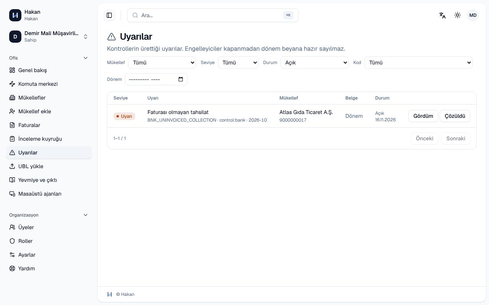

# Ofis çalışanı kılavuzu

> Günlük iş akışı: dosya yükleme, faturalar, inceleme kuyruğu, uyarılar ve yevmiye.

Ofis paneline girince **genel bakış** açılır. Ekranlar arasında kenar
menüden ya da **Ctrl+K** komut paletinden gezinin. Kenar menü geniş ekranda
tam, tablette ikon rayı olarak görünür; telefonda alttaki sekmeler (Pano,
Kuyruk, Mükellef, Uyarı, Daha) kullanılır.

Üst çubuktaki **Dönem** seçicisi bütün listeleri (inceleme kuyruğu, faturalar,
uyarılar, yevmiye) aynı döneme süzer. "Tüm dönemler" süzmez; genel bakış o
durumda beyan dönemini (önceki ay) gösterir. Seçim bu tarayıcıda ofis başına
saklanır.

## Günlük akış

1. **Sıradaki iş:** her mükellefin dönem kapanışında sıradaki adımını görün
   ve tek tıkla (onayınızla) çalıştırın.
2. **Genel bakış / Komuta merkezi:** işi geride olan mükellefleri görün.
3. **e-Fatura yükle:** gelen e-fatura / e-arşiv dosyalarını yükleyin.
4. **İnceleme kuyruğu:** hesap kodu önerilerini karara bağlayın.
5. **Uyarılar:** kontrollerin bulduğu sorunları kapatın.
6. **Fişler ve aktarım:** fişi onaylayın, Luca / Zirve dosyasını indirin
   (yetkiniz varsa).

## UBL yükleme

1. Üstten mükellefi seçin.
2. XML dosyalarını ya da bunları içeren ZIP'i alana sürükleyin (ya da
   tıklayıp seçin) ve **yükle**'ye basın.
3. **Yükleme raporu** kaç faturanın eklendiğini, kaçının zaten var olduğunu,
   kaçının atlandığını ve uyarı sayısını gösterir. Aynı ETTN ikinci kez
   eklenmez; aynı dosyayı yeniden yüklemek güvenlidir.

Dosyalar ofis bilgisayarında bir klasöre iniyorsa [masaüstü ajanı](masaustu.md)
klasörü izleyip bunları kendisi yükleyebilir.

### Evrak yükle: tür ve dönem

Aynı sayfadaki **Evrak yükle: tür ve dönem** bölümünde evrakın türünü
(fatura, Z raporu, masraf, banka ekstresi, diğer) ve hangi aya ait olduğunu
seçersiniz. Ay belge tarihinden önerilir: tarihi yazarsanız onun ayı,
e-Fatura XML'inde faturanın tarihi, Z raporu ve masraf fotoğrafında okunan
tarih; tarih yoksa içinde bulunulan ay. Seçilen ay kilitliyse üç seçenek
sorulur: **Reddet** (evrak işlenmez), **Geçmiş döneme düzeltme olarak işle**
(o ayın beyanı verildiyse düzeltme beyannamesi gerekebilir) ya da **Seçilen
aya uygula** (açık başka bir aya işlenir). Seçiminiz yüklemeyle birlikte
**Son yüklemeler** listesinde görünür. Mükellefin mobil uygulamadan ya da
WhatsApp'tan gönderdiği Z raporu ve masraf fişi de kendiliğinden belgenin
tarihindeki aya düşer; tarihi okunamazsa yükleme ayına düşer. Bölüm
**Ayarlar → Belgeler → Evrak yüklemede tür ve dönem** ile kapatılır.

## Faturalar

**Faturalar** seçili mükellefin yüklenen ve toplanan e-fatura / e-arşiv
kayıtlarını listeler. Satıra tıklayınca fatura görüntüsü, satırlar, vergi
özeti ve o faturadaki uyarılar açılır.

## İnceleme

**İnceleme kuyruğu**, güveni eşiğin altında kalan hesap kodu önerilerini en
düşük güvenden başlayarak listeler. Kuyruk ve karar ekranı tek sayfadadır:
solda öneriler, sağda seçili önerinin kaynak satırı, "Neden bu kod?" (öneren
ve güven) ve aynı karşı tarafla geçmiş kararlar. Telefonda öneriye dokununca
ayrıntı açılır.

| Tuş | İşlem |
|---|---|
| J / ↓ · ↑ | sonraki / önceki öneri |
| A | önerilen kodu onayla |
| E | kodu düzelt (hesap planında ara ya da kodu tam yazın, ör. 770.01.012) |
| K | onayla ve bu karşı taraf için kural yap (hep bu koda işlenir) |
| R | reddet |
| Z | son onayı ya da düzeltmeyi geri al |

Kodu düzeltirken "Bu karşı taraf için kural yap" kutusunu işaretlerseniz
düzeltilen kod kural olur. Üstteki şeritte "%… üstü N öneriyi toplu onayla"
ile güveni seçtiğiniz değerin üstündeki önerileri topluca onaylayabilirsiniz.
"Düşük güven" ve "Orta güven" düğmeleri kuyruğu süzer. Reddedilen öneri geri
alınamaz.

### Tablo görünümü

Çok sayıda kodu bir arada düzeltmek için başlıktaki **Tablo** düğmesine basın.
Öneriler Excel benzeri bir tabloda listelenir:

- **Hesap kodu** kolonuna yazın ya da Excel'den bir kolonu kopyalayıp
  yapıştırın (Ctrl+V). Değişen kod düzeltme olarak kaydedilir.
- **Karar** kolonunda "Onayla" önerilen kodu onaylar, "Reddet" öneriyi
  reddeder. Ctrl+D seçimin ilk satırını aşağı doldurur; köşedeki küçük kareyi
  sürükleyerek de doldurabilirsiniz.
- Ok tuşları, Tab ve Enter ile gezinin; Shift+ok ile aralık seçin. Ctrl+Z geri
  alır.
- Satırlar tek tek kaydedilir: Ctrl+S o satırı, **Tümünü kaydet** bütün
  değişen satırları kaydeder. Hatalı kod kırmızı işaretlenir ve kaydedilmez.

## Uyarılar

Kontroller (KDV tutarlılığı, eksik ya da silinmiş kayıt, banka eşleşmesi
vb.) uyarı üretir. **Engelleyici** uyarılar kapanmadan dönem beyana hazır
sayılmaz.

- Mükellefe ve koda göre süzün; dönem üst çubuktaki seçiciden gelir.
- **Faturayı aç** ile ilgili kayda gidin, sorunu düzeltin.
- Uyarıyı incelediyseniz **Gördüm**, sorunu giderdiyseniz **Çözüldü**
  ile işaretleyin. Düzelen kayıtlarda uyarı bir sonraki kontrolde
  kendiliğinden kapanır (**Kendiliğinden kapandı**).

## Yevmiye

Yevmiye fişi hazırlama, onay ve Luca / Zirve / Excel çıktısı
[Ofis yöneticisi kılavuzu](ofis-yoneticisi.md#7-yevmiye-ve-luca--zirve-çıktısı)nda
anlatılır. Bu ekranı göremiyorsanız rolünüzde yevmiye izni yoktur.

## Banka: hesap ekleme ve ekstre yükleme

Mükellefin ana sayfasındaki **Banka hesapları** bölümünden **Banka hesabı
ekle** ile hesap tanımlanır: banka, şube (isteğe bağlı), IBAN (isteğe
bağlı), hesap adı ve para birimi (TRY, USD, EUR). "Akbank TRY" demek yeter;
IBAN yazılınca banka kendiliğinden seçilir, kontrol hanesi tutmayan IBAN
kaydedilmez. Kapanan hesap **Pasife al** ile
kenara alınır; hareketleri silinmez, **Yeniden kullan** ile geri açılır.

**Banka** sayfasındaki **Ekstre yükle**, Ziraat, Halkbank, VakıfBank, İş
Bankası, Garanti BBVA, Akbank, Yapı Kredi, QNB, DenizBank ve Kuveyt Türk
internet şubelerinin Excel (.xlsx, .xls) ve CSV dışa aktarımlarını ve
MT940 dosyalarını okur. Biçim ve banka dosyanın içinden (başlık satırı,
IBAN'daki banka kodu, banka adı) tanınır; önizlemede hangi banka olduğu
yazar. Dosyadaki IBAN mükellefin bir hesabıyla eşleşirse hesap
kendiliğinden seçilir; dosyada IBAN yoksa hesabı siz seçersiniz. Tanınmayan
bir düzende kolonlar önizlemede eşlenir: Tarih, Açıklama ve Tutar (ya da
Borç ve Alacak) gerekir, Bakiye isteğe bağlıdır. Eski Excel 97-2003 (.xls)
dosyası da doğrudan okunur; .xlsx'e çevirmeniz gerekmez. Yalnız bozuk ya da
parola korumalı .xls okunamaz: Excel'de açıp yeniden kaydedin ya da CSV indirin.

**Eksik ekstreler:** her kullanımdaki hesabın satırında son altı kapanmış
ayın şeridi durur: **geldi**, **eksik** ya da **beklenmiyor**. O ay hareketi
ya da gün sonu bakiyesi olan hesabın ekstresi gelmiş sayılır; içinde
bulunulan ay henüz beklenmez, yeni eklenen hesabın geçen ayı beklenir,
pasif hesap sayılmaz. Eksik ayda **İste** mükellefe hazır başlıklı belge
isteği açar ("Akbank TRY hesabı – Ekim 2026 ekstresi"); son tarih, kanal ve
hatırlatma belge isteğindeki gibi seçilir, açık istek varsa ikincisi
açılmaz. **Eksiklerin hepsini iste** mükellefin bütün eksiklerini tek
seferde ister. Hareketi olmayan ay için **Geldi, hareket yok** deyin. Ana
sayfadaki **Eksik ekstreler** listesi bütün mükelleflerin eksiklerini hesap
ve ay ayrıntısıyla sıralar; oradan da tek tıkla istenir.

**Listeye ekle:** yüklenen ekstredeki hesap mükellefin listesinde yoksa
ekstre okunmaz, **Bu hesap listede yok** penceresi açılır. Banka, IBAN ve
para birimi dosyadan dolu gelir; **Listeye ekle** ile hesap eklenir ve aynı
dosya kendiliğinden yeniden okunur. Dosyada IBAN yoksa ekstre önce IBAN'a,
sonra bankaya (aynı bankada birden çok hesap varsa para birimine) göre
eşleşir.

## Banka: Luca ekstresi (CSV)

Mükellefin **Banka** sayfasındaki **Luca ekstresi** sekmesi, banka
hareketlerini Luca'nın "Banka Ekstreleri" ekranının okuyacağı CSV olarak
indirir.

1. Hesabı ve tarih aralığını seçin (varsayılan: üst çubuktaki dönem).
2. Tutar düzenini seçin: tek sütun işaretli (giriş +, çıkış −) ya da Borç /
   Alacak iki sütun. Ayraç noktalı virgül ya da virgül olabilir.
3. **CSV indir**. Dosya Windows-1254 kodludur; tarih gg.aa.yyyy, ondalık
   virgüldür.
4. Luca'daki ekstre tanımını bir kez kurun: sekmedeki **adım adım** rehber
   her CSV sütununun Luca'da hangi fiş sütununa ve veri türüne (Metin,
   Tarih, Para) eşleneceğini gösterir.

Daha önce dışa aktarılmış bir hareket yeniden bir dosyaya girerse indirme
sonrası uyarı çıkar ve hareketler listesinde "Luca'ya N kez aktarıldı"
işareti görünür. **İndirme geçmişi** her dosyayı hesap, tarih ve hareket
sayısıyla listeler. Biçim Luca'da doğrulanmadı; ilk aktarımı bir deneme
mükellefinde yapın.

## Sıradaki iş ve co-pilot

Kenar menüdeki **Sıradaki iş** ekranı, üst çubukta seçili dönemin (seçim
yoksa önceki ayın) kapanışını mükellef mükellef gösterir. Her satırda altı
adım vardır:

1. **Belgeler:** mükelleften istenen ve henüz gelmeyen belgeler.
2. **Banka:** hesap önerisi olmayan ya da önerisi onay bekleyen hareketler.
3. **Öneriler:** inceleme kuyruğunda bekleyen öneriler.
4. **Fişler:** onaylı banka hareketlerinden fiş taslağı oluşturma ve
   taslakları onaylama.
5. **Aktarım:** onaylı fişlerin Luca'ya ya da Zirve'ye gönderilmesi.
6. **Rapor:** aylık raporun mükellefe e-postayla gitmesi.

Yeşil adım tamamdır, sarı adımda iş vardır, kırmızı adım başarısız olmuştur.
Gri adımın o dönem karşılığı yoktur (ör. banka hareketi yok). Satırın
sağındaki düğme sıradaki işi açar. Değişiklik yapan bir işse önce onay
penceresi gelir; işlem siz **Onayla ve çalıştır** demeden başlamaz.

Adımın adı durumunu söyler: bitmiş adım "Fişler onaylı" der, bitmemiş adım
işin adını yazar ("Fiş onayı"). İşletme defteri ya da serbest meslek defteri
tutan mükellefte fiş adımı masraf fişleri ve Z raporlarıdır: onay bekleyenler
varsa adım o ekrana götürür, hepsi onaylıysa tamamdır. Banka adımı yalnız
ekstre kontrolüdür: kayıtlı banka hesabı varsa dönemin ekstresi beklenir
(**Banka ekstresine bak**), hesap yoksa adım isteğe bağlıdır ve kapanışı
engellemez. Bu mükellefe banka hesabı önerisi, fiş taslağı ya da Luca'ya
aktarım önerilmez. **Eksik belgelere bak** düğmesi
belge toplama ekranını yalnız o mükellefe süzülü açar; üstte o mükellefin
bekleyen belge istekleri listelenir, **İsteği aç** ile mükellef özetinde o
istek işaretli gelir. Zincirdeki belge rozeti de en eski bekleyen isteğin
kendisine götürür. **Bütün mükellefler** düğmesi süzgeci kaldırır.

**Belge istemek:** mükellef özetindeki **Açık belge istekleri** bölümünde
**Belge iste**'ye basın. Ne istediğinizi, son tarihi ve mükellefe nasıl
haber verileceğini seçin: **Uygulama bildirimi** (mobil uygulamaya da
düşer), **SMS** ve **E-posta**; istediğiniz kadarını işaretleyin.
**Hatırlatma** kutusundan "son tarihten 2 gün önce" gibi bir gün seçerseniz
o sabah saat 10.00'da aynı kanallardan bir hatırlatma gider. SMS ve e-posta
mükellef kartındaki telefona ve adrese gider; ofis SMS ayarı deneme
modundaysa kayıt tutulur ama gönderilmez. İsteğin satırında her kanalın son
durumu (Gönderildi, İletildi, Deneme modu, Gönderilmedi) ve hatırlatma günü
görünür; **Hatırlat** düğmesi hatırlatmayı hemen gönderir. Her gönderim
mükellefin **İletişim geçmişi**ne kanıt olarak yazılır.

- **Toplu mod:** birden fazla mükellef seçip **Seçilenlerin sıradaki işi**
  ile hepsinin sıradaki adımını tek onay penceresinde çalıştırın. İstemediğiniz
  adımın işaretini kaldırın.
- **Kısayollar:** J / K satır değiştirir, Enter sıradaki işi açar, X satırı
  seçer, B seçilenlerin sıradaki işini açar.
- **Komut:** ekrandaki kutuya ya da her ekranda **Ctrl+K** (Mac'te ⌘K)
  paletine bir cümle yazın. Örnek: "Atlas Gıda ekim fişlerini Luca'ya aktar",
  "Tüm mükelleflerin ekim raporunu gönder", "Atlas ekim kapanışı". Palette
  **Co-pilot'a sor** seçeneğini seçin. Co-pilot komutu adımlara böler ve
  onayınıza sunar. Gerekli ön adımları kendisi ekler: fişler onaylanmadan
  aktarım yapılamayacağı için önce onay adımını koyar.

Co-pilot yalnızca uygulamadaki mevcut işlemleri önerir. Her adım sizin
yetkinizle çalışır. Size atanmamış mükellefleri ve yetkiniz olmayan işlemleri
plana almaz, nedenini pencerede not olarak yazar. Ofiste yapay zekâ
tanımlıysa komutu o okur, tanımlı değilse komut kurallarla okunur.

## Mutabakat

Mükellef ayrıntısındaki **Mutabakat** sekmesi, üst çubukta seçili dönemin
mizanını portaldaki kaynaklarla karşılaştırır. Önce o dönemin mizanını
(tutarlarıyla) **Hesap planı** ekranından yükleyin, sonra **Karşılaştır**a
basın. Mizan yeniden yüklenirse ya da yeni belge gelirse **Yeniden
karşılaştır** deyin. Farkı değişmeyen hesaplarda kararınız ve notunuz korunur.

- **Hesaplar:** her ana hesap (102, 191, 391, 600, 770 …) için mizan
  hareketi ile fatura, banka, masraf, Z raporu ve bordro fişlerinin toplamı.
  Aynı yılın önceki ayının mizanı yüklüyse yalnızca o aydan bu yana olan
  hareket karşılaştırılır; yoksa yıl başından birikimli bakılır (açılış fişi
  farka girer). **Ayrıntı** kaynak türüne göre tutarları, fişlenmemiş
  kayıtları (eksik kayıt adayları) ve alt hesapları gösterir. Her farkın
  yanında bir açıklama önerisi vardır: aktarılmamış fiş taslakları,
  fişlenmemiş kayıtlar, yuvarlama, açılış fişi ya da portala yüklenmemiş
  kaynak gibi. Üç noktalı menüden farkı **Açıkla** (not zorunlu), **Çözüldü**,
  **Yok say** ya da **İncelemeye gönder** ile işaretleyin. İncelemeye giden
  fark inceleme kuyruğunda kabul edilince çözülür. Mizanın 102 bakiyesi
  banka ekstrelerinin son bakiyesiyle ayrıca denetlenir.
- **Cari:** karşı firma (VKN / TCKN) bazında mizandaki 120 / 320 bakiyesi
  (cari hafızasındaki hesaptan) ile faturalar ve eşleşen ödemelerden
  hesaplanan bakiye; dönemin Form BA (alış) ve BS (satış) tutarı ile beyan
  edilen satır. 5.000 TL'yi (KDV hariç) aşan firma formda olmalıdır.
- **BA/BS beyanı:** verilen (ya da verilecek) formun satırlarını Excel / CSV
  ile yükleyin (VKN/TCKN, Unvan, Belge Sayısı, Tutar) ya da elle ekleyin.
  Yükledikten sonra yeniden karşılaştırın.
- **Mektuplar:** Cari görünümünde **Mektup** ile karşı firmaya cari
  mutabakat mektubu hazırlayın. "Hemen e-postayla gönder" açıksa mektup PDF
  ekiyle ve tek tıkla yanıt bağlantısıyla gider. Karşı firma bağlantıdan
  "Mutabıkız" ya da kendi bakiyesiyle "Mutabık değiliz" der; bağlantı 60 gün
  geçerlidir. Telefonla ya da imzalı kâğıtla gelen yanıtı **Yanıt gir** ile
  kaydedin. "Mutabıkız" yanıtı cari satırını çözer.

## Mükellef raporu

Mükellef ayrıntısındaki **Rapor** sekmesi seçtiğiniz ayın ya da yılın
cirosunu, giderlerini (kategoriye göre), KDV'sini ve gelir-gider trendini
dört grafikte gösterir. Rakamlar portaldaki faturalardan, onaylı
masraflardan ve onaylı Z raporlarından hesaplanır; KDV tutarı tahminidir.

- **PDF indir**: mükellefe giden raporun aynısı (ofis adınızla).
- **E-postayla gönder**: raporu PDF ekiyle mükellefin kayıtlı e-postasına
  (ya da yazdığınız adrese) gönderir. Dönem yorumu yalnızca onaylıysa
  eklenir. Gönderimin durumu **Gönderim geçmişi**nde görünür.
- **Otomatik aylık gönderim**: açarsanız ay kapanınca, seçtiğiniz günden
  itibaren önceki ayın raporu bir kez kendiliğinden gönderilir.
- **Mükellefe KDV bildirimi**: **Mükellefe gönder** bu ayın güncel KDV
  durumunu ("ödeme çıkacak" ya da "ödeme çıkmayacak", tutar ve son ödeme
  günüyle) mükellefin paneline ve e-postasına ofis adınızla gönderir. İsterseniz
  kısa bir not ekleyin. Kartın altında mükellefe ne söylendiği ve ne zaman,
  o günkü rakamlarla görünür.
- **KDV nöbetçisi**: her sabah bu ayın KDV'si yeniden hesaplanır. Mükellefe
  söylenen durum yeni bir faturayla değiştiyse kartta **KDV durumu
  değişti** uyarısı çıkar ve size bildirim gelir; **Mükellefe yeni bilgi
  gönder** ile güncel durumu tek tıkla iletin. Sabahı beklemeden bakmak için
  **Şimdi kontrol et**e basın.

Birden çok mükellefe aynı anda göndermek için kenar çubuğundaki
**Raporlar** sayfasında mükellefleri seçip **Seçilenlere gönder**e basın.
E-posta adresi olmayan mükellefler atlanır ve size bildirilir.

### Ay sonu KDV raporu

**Raporlar** sayfasının üstündeki **KDV raporu** tablosu bütün
mükelleflerin içinde bulunulan aydaki satış KDV'sini, alış KDV'sini,
devreden KDV'sini ve ödenecek ya da sonraki aya devreden tahmini tutarı
gösterir. Böylece ödeme çıkacak mükellefi ay bitmeden görüp haber
verebilirsiniz. Ayın 29'undan itibaren (ofis ayarında değiştirilebilir;
ay kısaysa son gün) rapor "hazır" yazar ve kaç mükellefte ödeme çıktığını
söyler; o güne kadar rakamlar gelen faturalara göre anlık tahmindir.

- **Devri gir**: sistemde önceki ayların faturası yoksa ya da beyanname
  ile fark varsa, mükellefin devreden KDV'sini satırdan girin; tahmin bu
  tutarla yeniden hesaplanır.
- **Eşik aşıldı**: ödenecek KDV, uyarı ayarındaki eşiği geçti.
- Rapor ofis yöneticisinin **Ayarlar → KDV takibi** bölümünden kapatılabilir.

## Yabancı faturalar / KDV2

Mükellef yurt dışından hizmet aldıysa (Google Ads, AWS, yabancı yazılım
lisansı) bu hizmetin KDV'sini sorumlu sıfatıyla kendisi öder (2 No.lu KDV),
bazı hizmetlerde stopaj da çıkar. Beyan Luca'da verilir; mükellef
ayrıntısındaki **Yabancı faturalar / KDV2** sekmesinde faturalar ay ay
toplanır ve tutarlar hesaplanır. **Fatura ekle** ile satıcı, ülke, tutar,
döviz ve kuru girin; işlem türünü seçince ofisin oranları dolar (ör.
yazılım lisansı: %15 stopaj, brütleştirme). Brütleştirmede satıcıya ödenen
tutar nettir: matrah = tutar ÷ (1 − stopaj oranı); 100 USD için matrah
117,65, stopaj 17,65, KDV2 23,53 USD olur. TL karşılıkları kurla hesaplanır
(kuruşa yuvarlanır). Kuru boş bırakırsanız faturanın tarihinden önceki son
TCMB kuru kendiliğinden gelir; tutarın altında "TCMB, 21.11.2026" gibi
kaynağı yazar. Yazdığınız kur "Elle girildi" olarak kalır, otomatik kur onu
hiç değiştirmez. TCMB kuru da bulunamayan fatura "kur eksik" görünür, ay
toplamına girmez ve onaylanamaz; kuru satırdan girin. Kontrol ettiğiniz faturayı
**Onayla**; değiştirmek için önce **Onayı geri al**. **Excel indir** / **PDF
indir** ayın listesini toplamıyla verir.

Onaylı faturanın satırındaki **Fiş oluştur** fiş taslağını yazar (bilanço
esasındaki mükellefte; işletme defteri ve serbest meslek mükellefinde fiş
oluşmaz). Satırlar TL'dir, döviz tutarı ve kuru da taşır: gider hesabı (brüt)
borç, 191 indirilecek KDV borç, 360 ödenecek KDV2 alacak, varsa 360 stopaj
alacak, 320 satıcı (ya da 102 banka) ödenen net tutar alacak. Brütleştirmede
döviz brütü yuvarlandığı için birkaç kuruş fark çıkabilir (100 USD, kur 34,50:
0,09 TL); fark ayrı satıra (679 / 689) yazılır, fiş dengeli kalır. **Onaylıların
fişini oluştur** ayın fişi olmayan onaylı faturalarını tek seferde fişler. Fiş
**Yevmiye** ekranında diğer fişlerle kontrol edilir, onaylanır ve Luca'ya
aktarılır. Bir faturanın tek fişi olur; fiş varken onay geri alınmaz. Taslak
fişi satırdaki **Fişi kaldır** ile silebilirsiniz; aktarılmış fiş burada
kaldırılmaz. Hesap kodları **Ayarlar → Yabancı hizmet faturaları** bölümündedir
(gider hesabı işlem türüne göre; alt hesap yazılabilir, hesap planında olmayan
kod fişte uyarı verir).
Onaylı ve kuru girilmiş yabancı faturalar **Beyanlar** sekmesinde de görünür:
2 No.lu KDV önizlemesinde işlem türüne göre "Sorumlu sıfatıyla KDV (yurt dışı
hizmet)" satırları (TL matrah, oran, KDV2), muhtasar önizlemesinde stopajlı
olanlar için "Yurt dışı hizmet stopajı (KVK 30)" satırı çıkar ve toplamlara
eklenir; Excel / PDF özetine de girer. Onaysız ya da kursuz fatura beyana
alınmaz, kontrol listesinde uyarı olarak görünür; **Yabancı faturaları aç**
bağlantısıyla sekmeye geçip düzeltin. Beyanın kendisi yine Luca'da verilir.
Mükellef faturayı kendisi de gönderebilir: mükellef panelindeki **Yabancı
hizmet faturası gönder** kartından ya da WhatsApp'tan (uzantıda **Yabancı
fatura olarak kaydet**). Bu faturalar listede taslak olarak, "Mükellef
panelinden geldi" ya da "WhatsApp'tan kaydedildi" notuyla görünür;
**Belgeyi aç** gönderilen fotoğrafı ya da PDF'i açar. Fotoğraftan satıcı,
ülke, fatura no / tarih, tutar ve döviz yapay zekâ ile önerildiyse satırda
**Önerildi: kontrol edin** yazar; PDF'te ya da yapay zekâ kapalıyken alanlar
boş gelir. **Düzenle** ile belgeyle karşılaştırıp düzeltin, kuru girin ve
**Onayla**. Satıcı, ülke ve tutarı eksik fatura onaylanmaz; hiçbir şey
kendiliğinden onaylanmaz. **Otomasyonlar**'daki "Ayın 1'i yabancı
faturalarınızı gönderin" hazır kuralı açılırsa mükelleflere her ay
hatırlatma gider.

## Mükellef özeti: dört kart ve Luca'ya aktar

Mükellef ayrıntısının **Özet** sayfasında en üstte seçili ayın dört kartı
durur: **Fatura** (gelen / giden sayısı), **Z raporu**, **Masraf** (kaç
tanesi onay bekliyor, kaçı işlendi) ve **Banka** (bekleyen ve eşleşen
hareketler, yüklenmemiş ekstre). Karta tıklayınca o mükellefin o ayki listesi
açılır. Kartların yanındaki **Luca'ya aktar** dönemin onaylı fişlerinden Luca
fiş dosyasını üretir ve indirir; Luca'nın API'si olmadığı için dosyayı
Luca'ya siz yüklersiniz. Dosya .xlsx'tir ve tek başlık satırı Luca'nın fiş
Excel'iyle aynıdır: Fiş No, Fiş Tarihi, Fiş Açıklama, Hesap Kodu, Evrak No,
Evrak Tarihi, Detay Açıklama, Borç, Alacak, Miktar, Belge Türü, Para Birimi,
Kur, Döviz Tutar, TC/Vergi No. Her fatura tek fiştir (bütün satırları aynı
Fiş No), KDV ayrı satırdadır ve her fişin borcu alacağına eşittir.
Kontrol isteyen fiş varsa **Fişler** sayfasına
yönlendirilirsiniz. İşletme defteri ve serbest meslek defterinde yevmiye fişi
olmadığından düğme yerine nedeni yazar. Kartların altında **Diğer bölümler**
(Excel aktarımı, geçmiş dönem, beyannameler, dilekçeler...) kısa
açıklamalarıyla listelenir; üstteki sekmeler de yerinde durur.

### Listelerde Luca'ya aktar (Excel)

Mükellefin **Faturalar**, **Banka** ve **Z raporları** sayfalarında (Masraflar
gibi) **Luca'ya aktar (Excel)** düğmesi vardır. Açılan pencerede dönemi (ay)
seçin; faturalarda süzgeç "tümü" ise gelen ya da giden faturaları da seçin.
Luca'nın API'si yok, dosya iner, Luca'ya siz yüklersiniz. Dosya yukarıdaki
fiş Excel'iyle aynı başlık satırını taşır; her belge bir fiştir, her KDV
oranı kendi satırındadır (191 / 391 alt hesabı) ve borcu alacağını tutmayan
fiş dosyaya girmez. Hesap kodu onaylı değilse bekleyen öneri, o da yoksa ana
hesap (153 / 600, 120 / 320, 102) yazılır ve satırın açıklamasına "(hesap
kodu kontrol edin)" eklenir; bu satırlar ve dosyaya alınmayan belgeler
(dövizli, iade, tevkifatlı...) indirmeden sonra pencerede listelenir. Daha
önce Luca'ya giden belge (bu dosyayla ya da yevmiye dışa aktarımıyla) ikinci
dosyaya girmez; gerekirse yalnız o dosya için **Daha önce aktarılanları
yeniden dahil et** kutusunu işaretleyin. İşletme defteri ve serbest meslek
defterinde düğme görünmez.

### Ofis mobil uygulamasında mükellef

Ofis mobil uygulamasında mükellefe dokununca dört kartın altında seçili ayın
**KDV hesabı** görünür: ödenecek ya da sonraki aya devreden KDV, oran oran
hesaplanan ve indirilecek KDV, gelen ve giden fatura toplamları. **Eksik /
gedik** kartı geçen ayın gelmeyen banka ekstrelerini ve belgelerini, Z raporu
olmayan günleri ve eşitleme hatası veren bağlantıları sayar. **Kayıtlar**
bölümündeki sekmeler (Gelen faturalar, Giden faturalar, Banka hareketleri, Z
raporları, Masraflar / Fişler) ay seçilerek listelenir; satıra dokununca
kalemler, KDV kırılımı ve varsa PDF ya da fiş görseli açılır. **Son fişler**
ve **Son faturalar** da dokununca açılır; fiş görseli tam ekran büyür.
**Onay** sekmesinde her kartta mükellefin unvanı ve fiş görseli durur;
önerilen hesap kodunu **Değiştir** ile hesap planından arayıp seçersiniz,
**Onayla** seçtiğiniz kodu gönderir.

### Masrafta birden çok KDV oranı

Bir market fişinde hem %1 hem %20 KDV olabilir. **Masraflar** ekranında ve ofis
mobil uygulamasında her oran kendi satırında (matrah ve KDV) görünür. Easytrade
masrafı tek oranla gönderir; masrafın fiş görseli varsa portal görseli okur
(kişisel veriler maskelenerek) ve fiş toplamı Easytrade'in toplamını tutarsa
fişteki oranları yazar, masrafta **Fişten okundu** yazar. Tutmazsa ya da fiş
okunamazsa Easytrade'in tek oranı kalır ve **Fiş okunamadı / tutmadı** yazar;
oranları fişten kontrol edin. Elle masraf eklerken **Oran satırı ekle** ile
her oranı ayrı girersiniz. Luca dosyasında her oran kendi 191 satırına yazılır.

## İletişim bilgileri

Mükellef ayrıntısının özet sayfasındaki **İletişim bilgileri** bölümünde
mükellefin telefonu, e-postası ve yetkili kişisi (mükellef hesabının sahibi)
görünür; telefona ve e-postaya basınca arama ya da e-posta açılır.
Yazma yetkiniz varsa **Düzenle** ile telefonu ve e-postayı değiştirirsiniz:
Türkiye numaraları "0532 123 45 67" biçimine getirilir, hatalı numara ya da
e-posta alanın altında yazılır, boş bıraktığınız alan silinir. Her değişiklik
etkinlik kaydına düşer. Yalnız görüntüleme yetkisi olan çalışan düzenleme
düğmesini görmez. Yetkili kişi mükellef davetiyle gelir; müşavir mobil
uygulamasında mükellef ayrıntısının **İletişim** kartında da aynı bilgiler
görünür ve düzenlenir.

## Önemli belgeler

Mükellef ayrıntısının özet sayfasındaki **Önemli belgeler** bölümünde vergi
levhası, imza sirküleri, ticaret sicil gazetesi, kira sözleşmesi, ruhsat ve
vekâletname gibi sık istenen belgeler durur. **Önemli belge ekle** ile tür,
ad, geçerlilik bitişi ve notla yükleyin ya da **Arşiv** sekmesinde bir
belgenin yıldızına basıp "önemli" işaretleyin. Bitişi 30 gün içinde olan ya
da geçmiş belge renkli satırda görünür; yenisini zamanında isteyin.
**Mükellef görebilir** açık olan belgeyi mükellef kendi panelinde görür ve
indirir; belge bazında kapatabilirsiniz.

## Parçalı Z raporu

Uzun bir Z raporu tek karede çıkmıyorsa birkaç fotoğrafla gönderilebilir.
**Z raporları** sayfasında **Parçalı Z raporu yükle** ile fotoğrafları seçin;
sıra **Parça 1**, **Parça 2**, **Parça 3** diye görünür, oklarla sırayı
değiştirebilirsiniz (en fazla 5 parça). **Tek Z raporu olarak yükle** dedikten
sonra parçalar birlikte okunur ve tek bir Z raporu oluşur; listede "2 parça"
gibi görünür. Z raporunu açınca parçaların fotoğrafları sırasıyla durur.
Mükellef de mobil uygulamada Z raporu seçip birden çok fotoğraf çektiğinde
"tek Z raporu olarak birleştir" diyebilir. Ofis yöneticisi bunu **Ayarlar →
Belgeler → Parçalı Z raporu** ile kapatabilir; kapalıyken Z raporu yalnızca
tek fotoğrafla yüklenir.

## Defterler

Mükellef ayrıntısındaki **Defterler** sekmesine her dönem Luca'dan aldığınız
işletme defteri dökümünü (Excel ya da CSV) ve e-defter dosyalarını (yevmiye,
kebir, berat XML'leri ya da bunların ZIP'i) yükleyin: dönemi seçin, dosyayı
seçin, **Yükle**. Ekran hangi dönemde hangi dosyanın olduğunu ve eksik
dönemleri gösterir; **Defter dönemi** aylık ya da 3 aylık seçilir (3 aylıkta
çeyreğin herhangi bir ayına yüklenen defter o çeyreği karşılar). **Özet**
düğmesi dosyadan okunanı gösterir: işletme defterinde alış, gider ve satış
toplamları ile en büyük satırlar; e-defterde hesap planı ve ana hesap başına
borç / alacak. Luca'nın eski Excel (.xls) dosyaları da doğrudan okunur;
.xlsx'e çevirmeniz gerekmez. Okunamayan dosya (ör. bozuk ya da parolalı
.xls) yine saklanır. Luca ya da e-defter şifreniz sorulmaz.

Luca'dan aldığınız **mizanı** ve **ücret bordrosunu** da buraya
yükleyebilirsiniz; tür **Kendisi bulsun** iken dosya başlık yazısından
tanınır. Mizanda başlık satırı (Hesap Kodu, Hesap Adı, Borç, Alacak, Borç
Bakiyesi, Alacak Bakiyesi) kaçıncı satırda olursa olsun bulunur, dönem üst
bilgideki tarih aralığından okunur; özet ana hesap toplamlarını ve mizanın
dengede olup olmadığını gösterir. Bordroda alt özetteki brüt, SGK işçi /
işveren, işsizlik işçi / işveren, gelir vergisi, damga vergisi, net ve kişi
sayısı okunur; bordro fişini bu toplamlarla kesersiniz. Mizan ve bordro
eksik dönem sayımında defter yerine geçmez. Luca bordroyu ya da mizanı eski
.xls olarak verirse dosyayı olduğu gibi yükleyin: tür dosyanın içindeki
başlıktan, o yetmezse dosya adından ("bordro", "mizan") bulunur.

## Sık sorulanlar

- **"Çok fazla deneme" uyarısı:** kısa sürede çok sayıda istek gönderdiniz
  (giriş, yükleme vb.). Yazılan süre kadar bekleyin.
- **Yükleme "dosya türü izinli değil" diyor:** dosya yöneticisi
  çalıştırılabilir dosya, betik ve HTML kabul etmez; görsel ya da PDF diye
  yüklenen dosyanın içeriği de gerçekten görsel / PDF olmalıdır.
- **Mükellef listede yok:** mükellef ekleme talebinin onaylanması gerekir;
  ya da size o mükellef atanmamıştır. Yöneticinize sorun.
