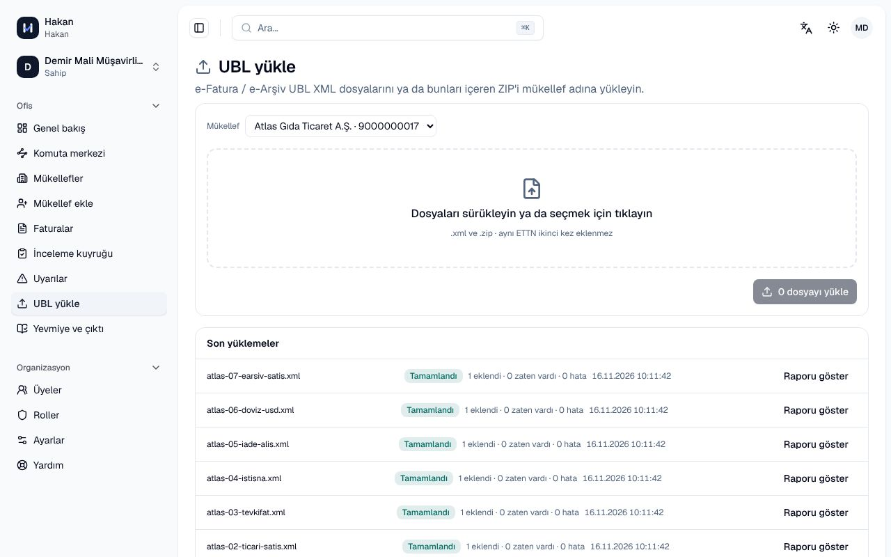
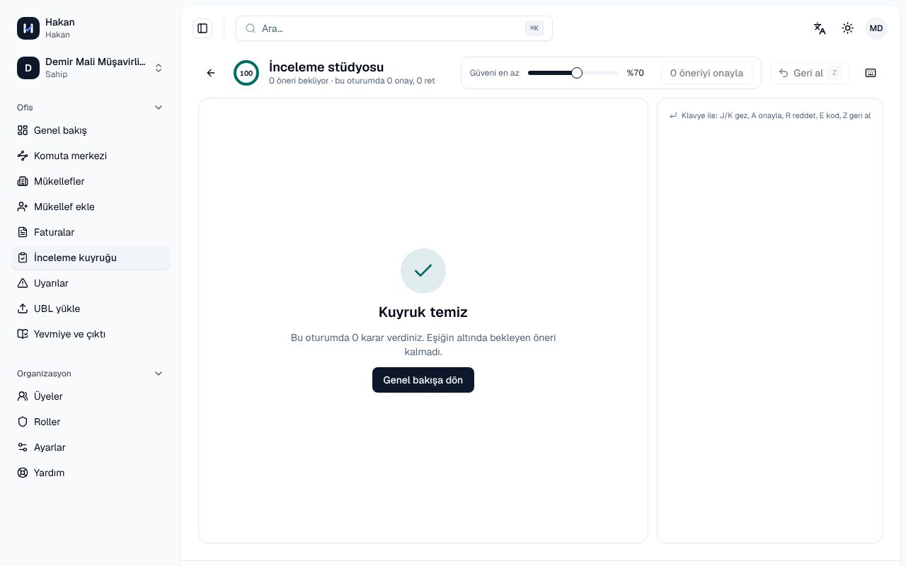

# Ofis çalışanı kılavuzu

> Günlük iş akışı: dosya yükleme, faturalar, inceleme kuyruğu, uyarılar ve yevmiye.

Ofis paneline girince **genel bakış** açılır. Ekranlar arasında kenar
çubuğundan ya da **Ctrl+K** komut paletinden gezinin.

## Günlük akış

1. **Genel bakış / Komuta merkezi:** işi geride olan mükellefleri görün.
2. **UBL yükle:** gelen e-fatura / e-arşiv dosyalarını yükleyin.
3. **İnceleme kuyruğu:** hesap kodu önerilerini karara bağlayın.
4. **Uyarılar:** kontrollerin bulduğu sorunları kapatın.
5. **Yevmiye ve çıktı:** fişi onaylayın, Luca / Zirve dosyasını indirin
   (yetkiniz varsa).

## UBL yükleme

1. Üstten mükellefi seçin.
2. XML dosyalarını ya da bunları içeren ZIP'i alana sürükleyin (ya da
   tıklayıp seçin) ve **yükle**'ye basın.
3. **Yükleme raporu** kaç faturanın eklendiğini, kaçının zaten var olduğunu,
   kaçının atlandığını ve uyarı sayısını gösterir. Aynı ETTN ikinci kez
   eklenmez; aynı dosyayı yeniden yüklemek güvenlidir.

Dosyalar ofis bilgisayarında bir klasöre iniyorsa [masaüstü ajanı](masaustu.md)
klasörü izleyip bunları kendisi yükleyebilir.

## Faturalar

**Faturalar** seçili mükellefin yüklenen ve toplanan e-fatura / e-arşiv
kayıtlarını listeler. Satıra tıklayınca fatura görüntüsü, satırlar, vergi
özeti ve o faturadaki uyarılar açılır.

## İnceleme

**İnceleme kuyruğu**, güveni eşiğin altında kalan hesap kodu önerilerini en
düşük güvenden başlayarak listeler. Her öneride kaynak satır, öneren (kural,
model ya da belge) ve aynı karşı tarafla geçmiş kararlar görünür.

**İnceleme stüdyosu** aynı kuyruğu klavyeyle hızlı karara bağlamak içindir:

| Tuş | İşlem |
|---|---|
| J / K | sonraki / önceki öneri |
| A | önerilen kodu onayla |
| R | reddet |
| E | kodu değiştir (hesap planında ara ya da kodu tam yazın, ör. 770.01.012) |
| Z | son onayı ya da düzeltmeyi geri al |

"Güveni en az %…" ile eşiğin üstündeki önerileri topluca onaylayabilirsiniz.
Reddedilen öneri geri alınamaz.

## Uyarılar

Kontroller (KDV tutarlılığı, eksik ya da silinmiş kayıt, banka eşleşmesi
vb.) uyarı üretir. **Engelleyici** uyarılar kapanmadan dönem beyana hazır
sayılmaz.

- Mükellefe, koda ve döneme göre süzün.
- **Faturayı aç** ile ilgili kayda gidin, sorunu düzeltin.
- Uyarıyı incelediyseniz **Gördüm**, sorunu giderdiyseniz **Çözüldü**
  ile işaretleyin. Düzelen kayıtlarda uyarı bir sonraki kontrolde
  kendiliğinden kapanır (**Kendiliğinden kapandı**).

## Yevmiye

Yevmiye fişi hazırlama, onay ve Luca / Zirve / Excel çıktısı
[Ofis yöneticisi kılavuzu](ofis-yoneticisi.md#7-yevmiye-ve-luca--zirve-ciktisi)nda
anlatılır. Bu ekranı göremiyorsanız rolünüzde yevmiye izni yoktur.

## Sık sorulanlar

- **"Çok fazla deneme" uyarısı:** kısa sürede çok sayıda istek gönderdiniz
  (giriş, yükleme vb.). Yazılan süre kadar bekleyin.
- **Yükleme "dosya türü izinli değil" diyor:** dosya yöneticisi
  çalıştırılabilir dosya, betik ve HTML kabul etmez; görsel ya da PDF diye
  yüklenen dosyanın içeriği de gerçekten görsel / PDF olmalıdır.
- **Mükellef listede yok:** mükellef ekleme talebinin onaylanması gerekir;
  ya da size o mükellef atanmamıştır. Yöneticinize sorun.
