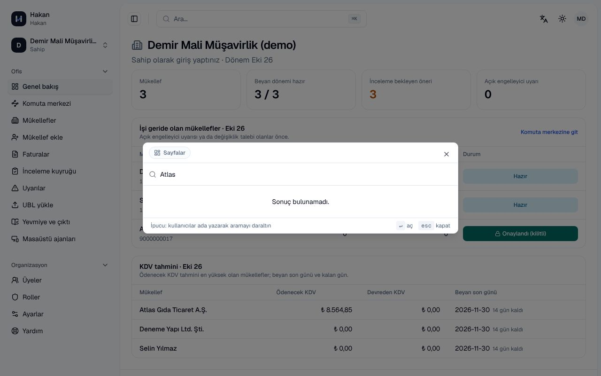
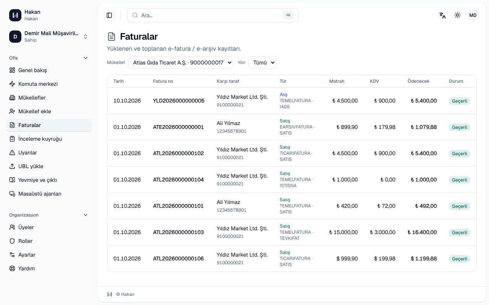

# Ofis çalışanı kılavuzu

> Günlük iş akışı: dosya yükleme, faturalar, inceleme kuyruğu, uyarılar ve yevmiye.

Ofis paneline girince **genel bakış** açılır. Ekranlar arasında kenar
menüden ya da **Ctrl+K** komut paletinden gezinin. Kenar menü geniş ekranda
tam, tablette ikon rayı olarak görünür; telefonda alttaki sekmeler (Pano,
Kuyruk, Mükellef, Uyarı, Daha) kullanılır.

Üst çubuktaki **Dönem** seçicisi bütün listeleri (inceleme kuyruğu, faturalar,
uyarılar, yevmiye) aynı döneme süzer. "Tüm dönemler" süzmez; genel bakış o
durumda beyan dönemini (önceki ay) gösterir. Seçim bu tarayıcıda ofis başına
saklanır.

## Günlük akış

1. **Sıradaki iş:** her mükellefin dönem kapanışında sıradaki adımını görün
   ve tek tıkla (onayınızla) çalıştırın.
2. **Genel bakış / Komuta merkezi:** işi geride olan mükellefleri görün.
3. **e-Fatura yükle:** gelen e-fatura / e-arşiv dosyalarını yükleyin.
4. **İnceleme kuyruğu:** hesap kodu önerilerini karara bağlayın.
5. **Uyarılar:** kontrollerin bulduğu sorunları kapatın.
6. **Fişler ve aktarım:** fişi onaylayın, Luca / Zirve dosyasını indirin
   (yetkiniz varsa).

## UBL yükleme

1. Üstten mükellefi seçin.
2. XML dosyalarını ya da bunları içeren ZIP'i alana sürükleyin (ya da
   tıklayıp seçin) ve **yükle**'ye basın.
3. **Yükleme raporu** kaç faturanın eklendiğini, kaçının zaten var olduğunu,
   kaçının atlandığını ve uyarı sayısını gösterir. Aynı ETTN ikinci kez
   eklenmez; aynı dosyayı yeniden yüklemek güvenlidir.

Dosyalar ofis bilgisayarında bir klasöre iniyorsa [masaüstü ajanı](masaustu.md)
klasörü izleyip bunları kendisi yükleyebilir.

## Faturalar

**Faturalar** seçili mükellefin yüklenen ve toplanan e-fatura / e-arşiv
kayıtlarını listeler. Satıra tıklayınca fatura görüntüsü, satırlar, vergi
özeti ve o faturadaki uyarılar açılır.

## İnceleme

**İnceleme kuyruğu**, güveni eşiğin altında kalan hesap kodu önerilerini en
düşük güvenden başlayarak listeler. Kuyruk ve karar ekranı tek sayfadadır:
solda öneriler, sağda seçili önerinin kaynak satırı, "Neden bu kod?" (öneren
ve güven) ve aynı karşı tarafla geçmiş kararlar. Telefonda öneriye dokununca
ayrıntı açılır.

| Tuş | İşlem |
|---|---|
| J / ↓ · ↑ | sonraki / önceki öneri |
| A | önerilen kodu onayla |
| E | kodu düzelt (hesap planında ara ya da kodu tam yazın, ör. 770.01.012) |
| K | onayla ve bu karşı taraf için kural yap (hep bu koda işlenir) |
| R | reddet |
| Z | son onayı ya da düzeltmeyi geri al |

Kodu düzeltirken "Bu karşı taraf için kural yap" kutusunu işaretlerseniz
düzeltilen kod kural olur. Üstteki şeritte "%… üstü N öneriyi toplu onayla"
ile güveni seçtiğiniz değerin üstündeki önerileri topluca onaylayabilirsiniz.
"Düşük güven" ve "Orta güven" düğmeleri kuyruğu süzer. Reddedilen öneri geri
alınamaz.

### Tablo görünümü

Çok sayıda kodu bir arada düzeltmek için başlıktaki **Tablo** düğmesine basın.
Öneriler Excel benzeri bir tabloda listelenir:

- **Hesap kodu** kolonuna yazın ya da Excel'den bir kolonu kopyalayıp
  yapıştırın (Ctrl+V). Değişen kod düzeltme olarak kaydedilir.
- **Karar** kolonunda "Onayla" önerilen kodu onaylar, "Reddet" öneriyi
  reddeder. Ctrl+D seçimin ilk satırını aşağı doldurur; köşedeki küçük kareyi
  sürükleyerek de doldurabilirsiniz.
- Ok tuşları, Tab ve Enter ile gezinin; Shift+ok ile aralık seçin. Ctrl+Z geri
  alır.
- Satırlar tek tek kaydedilir: Ctrl+S o satırı, **Tümünü kaydet** bütün
  değişen satırları kaydeder. Hatalı kod kırmızı işaretlenir ve kaydedilmez.

## Uyarılar

Kontroller (KDV tutarlılığı, eksik ya da silinmiş kayıt, banka eşleşmesi
vb.) uyarı üretir. **Engelleyici** uyarılar kapanmadan dönem beyana hazır
sayılmaz.

- Mükellefe ve koda göre süzün; dönem üst çubuktaki seçiciden gelir.
- **Faturayı aç** ile ilgili kayda gidin, sorunu düzeltin.
- Uyarıyı incelediyseniz **Gördüm**, sorunu giderdiyseniz **Çözüldü**
  ile işaretleyin. Düzelen kayıtlarda uyarı bir sonraki kontrolde
  kendiliğinden kapanır (**Kendiliğinden kapandı**).

## Yevmiye

Yevmiye fişi hazırlama, onay ve Luca / Zirve / Excel çıktısı
[Ofis yöneticisi kılavuzu](ofis-yoneticisi.md#7-yevmiye-ve-luca--zirve-çıktısı)nda
anlatılır. Bu ekranı göremiyorsanız rolünüzde yevmiye izni yoktur.

## Banka: Luca ekstresi (CSV)

Mükellefin **Banka** sayfasındaki **Luca ekstresi** sekmesi, banka
hareketlerini Luca'nın "Banka Ekstreleri" ekranının okuyacağı CSV olarak
indirir.

1. Hesabı ve tarih aralığını seçin (varsayılan: üst çubuktaki dönem).
2. Tutar düzenini seçin: tek sütun işaretli (giriş +, çıkış −) ya da Borç /
   Alacak iki sütun. Ayraç noktalı virgül ya da virgül olabilir.
3. **CSV indir**. Dosya Windows-1254 kodludur; tarih gg.aa.yyyy, ondalık
   virgüldür.
4. Luca'daki ekstre tanımını bir kez kurun: sekmedeki **adım adım** rehber
   her CSV sütununun Luca'da hangi fiş sütununa ve veri türüne (Metin,
   Tarih, Para) eşleneceğini gösterir.

Daha önce dışa aktarılmış bir hareket yeniden bir dosyaya girerse indirme
sonrası uyarı çıkar ve hareketler listesinde "Luca'ya N kez aktarıldı"
işareti görünür. **İndirme geçmişi** her dosyayı hesap, tarih ve hareket
sayısıyla listeler. Biçim Luca'da doğrulanmadı; ilk aktarımı bir deneme
mükellefinde yapın.

## Sıradaki iş ve co-pilot

Kenar menüdeki **Sıradaki iş** ekranı, üst çubukta seçili dönemin (seçim
yoksa önceki ayın) kapanışını mükellef mükellef gösterir. Her satırda altı
adım vardır:

1. **Belgeler:** mükelleften istenen ve henüz gelmeyen belgeler.
2. **Banka:** hesap önerisi olmayan ya da önerisi onay bekleyen hareketler.
3. **Öneriler:** inceleme kuyruğunda bekleyen öneriler.
4. **Fişler:** onaylı banka hareketlerinden fiş taslağı oluşturma ve
   taslakları onaylama.
5. **Aktarım:** onaylı fişlerin Luca'ya ya da Zirve'ye gönderilmesi.
6. **Rapor:** aylık raporun mükellefe e-postayla gitmesi.

Yeşil adım tamamdır, sarı adımda iş vardır, kırmızı adım başarısız olmuştur.
Gri adımın o dönem karşılığı yoktur (ör. banka hareketi yok). Satırın
sağındaki düğme sıradaki işi açar. Değişiklik yapan bir işse önce onay
penceresi gelir; işlem siz **Onayla ve çalıştır** demeden başlamaz.

- **Toplu mod:** birden fazla mükellef seçip **Seçilenlerin sıradaki işi**
  ile hepsinin sıradaki adımını tek onay penceresinde çalıştırın. İstemediğiniz
  adımın işaretini kaldırın.
- **Kısayollar:** J / K satır değiştirir, Enter sıradaki işi açar, X satırı
  seçer, B seçilenlerin sıradaki işini açar.
- **Komut:** ekrandaki kutuya ya da her ekranda **Ctrl+K** (Mac'te ⌘K)
  paletine bir cümle yazın. Örnek: "Atlas Gıda ekim fişlerini Luca'ya aktar",
  "Tüm mükelleflerin ekim raporunu gönder", "Atlas ekim kapanışı". Palette
  **Co-pilot'a sor** seçeneğini seçin. Co-pilot komutu adımlara böler ve
  onayınıza sunar. Gerekli ön adımları kendisi ekler: fişler onaylanmadan
  aktarım yapılamayacağı için önce onay adımını koyar.

Co-pilot yalnızca uygulamadaki mevcut işlemleri önerir. Her adım sizin
yetkinizle çalışır. Size atanmamış mükellefleri ve yetkiniz olmayan işlemleri
plana almaz, nedenini pencerede not olarak yazar. Ofiste yapay zekâ
tanımlıysa komutu o okur, tanımlı değilse komut kurallarla okunur.

## Mutabakat

Mükellef ayrıntısındaki **Mutabakat** sekmesi, üst çubukta seçili dönemin
mizanını portaldaki kaynaklarla karşılaştırır. Önce o dönemin mizanını
(tutarlarıyla) **Hesap planı** ekranından yükleyin, sonra **Karşılaştır**a
basın. Mizan yeniden yüklenirse ya da yeni belge gelirse **Yeniden
karşılaştır** deyin. Farkı değişmeyen hesaplarda kararınız ve notunuz korunur.

- **Hesaplar:** her ana hesap (102, 191, 391, 600, 770 …) için mizan
  hareketi ile fatura, banka, masraf, Z raporu ve bordro fişlerinin toplamı.
  Aynı yılın önceki ayının mizanı yüklüyse yalnızca o aydan bu yana olan
  hareket karşılaştırılır; yoksa yıl başından birikimli bakılır (açılış fişi
  farka girer). **Ayrıntı** kaynak türüne göre tutarları, fişlenmemiş
  kayıtları (eksik kayıt adayları) ve alt hesapları gösterir. Her farkın
  yanında bir açıklama önerisi vardır: aktarılmamış fiş taslakları,
  fişlenmemiş kayıtlar, yuvarlama, açılış fişi ya da portala yüklenmemiş
  kaynak gibi. Üç noktalı menüden farkı **Açıkla** (not zorunlu), **Çözüldü**,
  **Yok say** ya da **İncelemeye gönder** ile işaretleyin. İncelemeye giden
  fark inceleme kuyruğunda kabul edilince çözülür. Mizanın 102 bakiyesi
  banka ekstrelerinin son bakiyesiyle ayrıca denetlenir.
- **Cari:** karşı firma (VKN / TCKN) bazında mizandaki 120 / 320 bakiyesi
  (cari hafızasındaki hesaptan) ile faturalar ve eşleşen ödemelerden
  hesaplanan bakiye; dönemin Form BA (alış) ve BS (satış) tutarı ile beyan
  edilen satır. 5.000 TL'yi (KDV hariç) aşan firma formda olmalıdır.
- **BA/BS beyanı:** verilen (ya da verilecek) formun satırlarını Excel / CSV
  ile yükleyin (VKN/TCKN, Unvan, Belge Sayısı, Tutar) ya da elle ekleyin.
  Yükledikten sonra yeniden karşılaştırın.
- **Mektuplar:** Cari görünümünde **Mektup** ile karşı firmaya cari
  mutabakat mektubu hazırlayın. "Hemen e-postayla gönder" açıksa mektup PDF
  ekiyle ve tek tıkla yanıt bağlantısıyla gider. Karşı firma bağlantıdan
  "Mutabıkız" ya da kendi bakiyesiyle "Mutabık değiliz" der; bağlantı 60 gün
  geçerlidir. Telefonla ya da imzalı kâğıtla gelen yanıtı **Yanıt gir** ile
  kaydedin. "Mutabıkız" yanıtı cari satırını çözer.

## Mükellef raporu

Mükellef ayrıntısındaki **Rapor** sekmesi seçtiğiniz ayın ya da yılın
cirosunu, giderlerini (kategoriye göre), KDV'sini ve gelir-gider trendini
dört grafikte gösterir. Rakamlar portaldaki faturalardan, onaylı
masraflardan ve onaylı Z raporlarından hesaplanır; KDV tutarı tahminidir.

- **PDF indir**: mükellefe giden raporun aynısı (ofis adınızla).
- **E-postayla gönder**: raporu PDF ekiyle mükellefin kayıtlı e-postasına
  (ya da yazdığınız adrese) gönderir. Dönem yorumu yalnızca onaylıysa
  eklenir. Gönderimin durumu **Gönderim geçmişi**nde görünür.
- **Otomatik aylık gönderim**: açarsanız ay kapanınca, seçtiğiniz günden
  itibaren önceki ayın raporu bir kez kendiliğinden gönderilir.

Birden çok mükellefe aynı anda göndermek için kenar çubuğundaki
**Raporlar** sayfasında mükellefleri seçip **Seçilenlere gönder**e basın.
E-posta adresi olmayan mükellefler atlanır ve size bildirilir.

## Önemli belgeler

Mükellef ayrıntısının özet sayfasındaki **Önemli belgeler** bölümünde vergi
levhası, imza sirküleri, ticaret sicil gazetesi, kira sözleşmesi, ruhsat ve
vekâletname gibi sık istenen belgeler durur. **Önemli belge ekle** ile tür,
ad, geçerlilik bitişi ve notla yükleyin ya da **Arşiv** sekmesinde bir
belgenin yıldızına basıp "önemli" işaretleyin. Bitişi 30 gün içinde olan ya
da geçmiş belge renkli satırda görünür; yenisini zamanında isteyin.
**Mükellef görebilir** açık olan belgeyi mükellef kendi panelinde görür ve
indirir; belge bazında kapatabilirsiniz.

## Sık sorulanlar

- **"Çok fazla deneme" uyarısı:** kısa sürede çok sayıda istek gönderdiniz
  (giriş, yükleme vb.). Yazılan süre kadar bekleyin.
- **Yükleme "dosya türü izinli değil" diyor:** dosya yöneticisi
  çalıştırılabilir dosya, betik ve HTML kabul etmez; görsel ya da PDF diye
  yüklenen dosyanın içeriği de gerçekten görsel / PDF olmalıdır.
- **Mükellef listede yok:** mükellef ekleme talebinin onaylanması gerekir;
  ya da size o mükellef atanmamıştır. Yöneticinize sorun.
