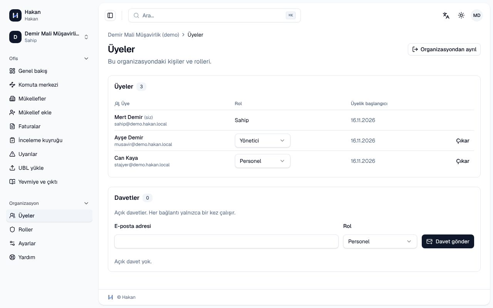
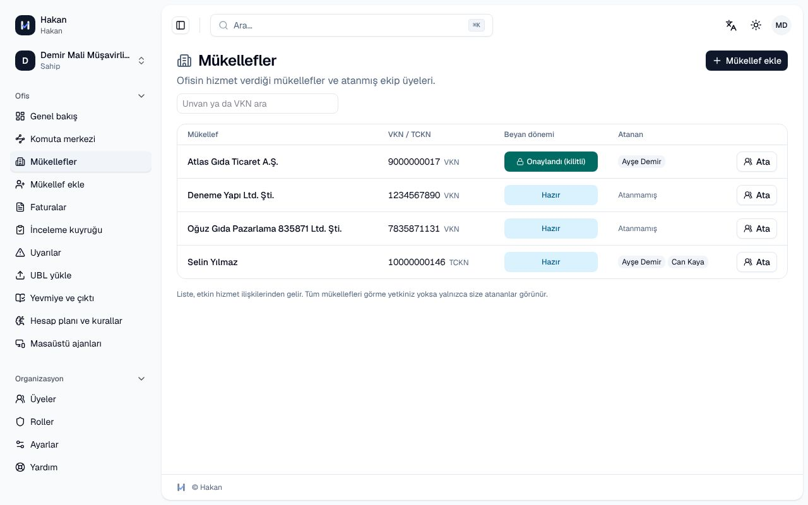
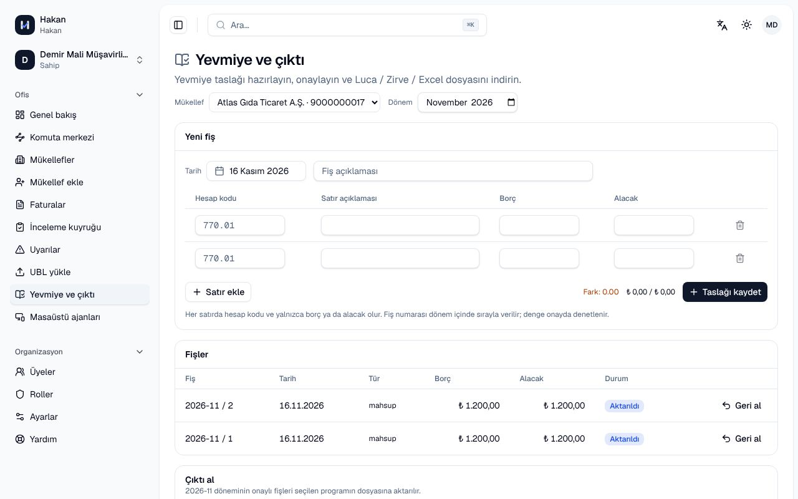

# Ofis yöneticisi kılavuzu

> Ofisi kurun, ekibi davet edin, mükellef ekleyin; inceleme, yevmiye ve Luca / Zirve çıktısını yönetin.

Bu kılavuz ofis **sahibi** ve **yönetici** rolündeki kullanıcılar içindir.
Günlük işler (UBL yükleme, inceleme, uyarılar) için
[Ofis çalışanı kılavuzu](ofis-calisani.md)na bakın.

## 1. İlk giriş ve genel bakış

1. Size gelen davet e-postasındaki bağlantıyla hesabınızı açın ya da
   `/login` sayfasından e-posta ve parolanızla girin. Hesabınızda iki adımlı
   doğrulama açıksa doğrulama uygulamanızdaki kodu da girin.
2. Giriş sonrası ofis panelinin **genel bakış** sayfası açılır. Üstte beyan
   dönemine kalan gün ve KDV son günü, altında dönem tacı (beyana hazır
   mükellef sayısı, istenen belgeler ve müşavir onayı) yazar.
3. Genel bakış, işi geride olan mükellefleri (açık engelleyici uyarısı ya da
   değişiklik talebi olanlar önce) ve ödenecek KDV tahmini en yüksek
   mükellefleri gösterir.

Ofis yeni açıldıysa genel bakışın üstünde **Ofis kurulumunu tamamlayın**
kartı görünür. **Kuruluma devam et** altı adımlık sihirbazı açar: ofis
bilgileri, ekip, mükellef listesi, muhasebe programı, fatura kaynakları ve
mükellef davetleri. Soldaki listeden istediğiniz adıma geçebilir, **Geri** ile
dönebilir ya da **Bu adımı atla** ile ilerleyebilirsiniz. Mükellef listesinde
hatalı satırların VKN ve unvanını tabloda düzeltip **Düzeltmeleri uygula** ile
listeyi yeniden kontrol ettirirsiniz. Yarıda bırakılan kurulum genel bakıştaki
karttan sürer.

Her ekrana kenar çubuğundan ya da **Ctrl+K** (macOS'ta ⌘K) komut paletinden
gidebilirsiniz: mükellef adı ya da ekran adı yazın.

## 2. Ofis ayarları

**Ayarlar** sayfasından ofisin görünen adını değiştirirsiniz. Ofisin adresi
(kısa adı, ör. `/t/demo-smmm`) platform tarafından yönetilir; değişmesi
gerekiyorsa platform yöneticisine yazın.

Ofis adına veri işleme sözleşmesi (KVKK) onayı da bu sayfadadır. Sözleşme
metni `/legal/...` sayfalarında yayımlanır; bu kılavuz o metinleri özetlemez.

Ayarlar dört bölümdür (geniş ekranda soldaki menüden, telefonda üstten):

- **Ofis bilgileri:** ad ve veri işleme sözleşmesi.
- **Yapay zekâ ve onay:**
  - **Otomatik onay eşiği** (%80–99): güveni bu değerin üstündeki hesap kodu
    önerileri kuyruğa düşmeden onaylanır. Kaydırırken son 30 günde bu eşikle
    kaç önerinin kendiliğinden onaylanacağı, bunlardan kaçının sonradan
    düzeltildiği ve kaçının kuyruğa düşeceği gösterilir. Otomatik onayı
    tamamen kapatabilirsiniz.
  - **Kural adayı eşiği:** kaç tutarlı karardan sonra kural adayı
    çıkacağı (2–10) ve hangi kararların sayılacağı. Bu ayarı ofis sahibi ve
    yöneticisi değiştirir.
- **Masaüstü ajanları:** ofise bağlı ajanlar ve durumları.
- **Görünüm:** tema (kristal mavi ya da yeşil; açık, koyu ya da sistemi izle).
  Yalnızca sizin hesabınız için geçerlidir.

## 3. Kullanıcılar ve roller

**Üyeler** sayfasında ofisteki kişiler ve rolleri listelenir.

- **Davet:** "Birini davet et" alanına e-posta adresini yazın, rolü seçin ve
  **Davet gönder**'e basın. Kişi e-postadaki bağlantıyla katılır. Davet
  bağlantıları tek kullanımlıktır ve süreleri dolar; gerekirse yeniden davet
  edin.
- **Rol değiştirme ve çıkarma:** üyenin satırındaki işlemlerden yapılır.
  Çıkarılan kişi ofise erişimini hemen kaybeder.
- **Roller** sayfası her rolün izinlerini gösterir. Stajyer gibi kısıtlı
  rollerin yevmiye ya da ayar ekranlarını görmemesi normaldir.

Kötüye kullanıma karşı davet, giriş ve şifre sıfırlama uçlarında hız sınırı
vardır. Kısa sürede çok sayıda davet gönderirseniz bir süre beklemeniz
istenir.

## 4. Mükellef ekleme

**Mükellef ekle** sayfasından VKN ya da TCKN ile mükellef eklersiniz.

1. Unvanı (ya da ad soyadı), VKN/TCKN'yi ve mükellefin iletişim e-postasını
   girin.
2. Mükellefe bir onay bağlantısı gider. Mükellef onaylayınca **hizmet
   ilişkisi** açılır ve mükellef **Mükellefler** listesinde görünür.
3. "Gönderilen talepler" listesinde her talebin durumu görünür. Bekleyen bir
   talebi iptal ederseniz bağlantı geçersiz olur.

Mükellef başka bir ofisle çalışıyorsa, onay verdiğinde önceki hizmet ilişkisi
sona erer. Mükellef bunu onay ekranında görür.

Mükellef kullanıcılarına panel daveti (fiş gönderme, belge yükleme) ofis
tarafından gönderilir; kullanıcı e-postadaki bağlantıyla daveti kabul eder.
Davet gönderme ekranı ofis panelinde henüz yoktur; şimdilik API ile ya da
destek ekibi aracılığıyla gönderilir. Mükellef tarafı için
[Mükellef kılavuzu](mukellef.md)na bakın.

## 5. Entegratör ve kaynak bağlantıları

Faturalar üç yoldan gelir:

| Yol | Nasıl |
|---|---|
| UBL yükleme | Ofis panelinde **e-Fatura yükle** ya da mükellef panelinde **Belge yükle** (XML / ZIP) |
| Masaüstü ajanı | Ofis bilgisayarındaki bir klasörü izler, düşen XML / ZIP'i yükler: [Masaüstü ajanı kılavuzu](masaustu.md). Ajanların durumu **Masaüstü ajanları** sayfasında: [ajanları aç](/t?to=agents) |
| Ön muhasebe programları | Paraşüt, KolayBi ve Easytrade bağlantıları, mükellef (hizmet ilişkisi) başına |

> Paraşüt, KolayBi ve Easytrade bağlantılarının ofis panelinde henüz ekranı yoktur. Bağlantı şimdilik API ile ya da destek ekibi aracılığıyla kurulur. Paraşüt'te mükellef uygulamaya yetki verir, sonra şirket seçilir. KolayBi ve Easytrade'de mükellefin API bilgileri girilir. Bağlantıdan sonra senkronizasyon elle ya da zamanlanmış olarak çalışır; gelen kayıtlar **Faturalar** ve **Uyarılar** ekranlarında görünür.

## 6. İnceleme kuyruğu

Faturaların satırlarına hesap kodu önerilir. Güven skoru ofis eşiğinin
altında kalan öneriler **İnceleme kuyruğu**na düşer; eşiğin üstündekiler
otomatik onaylanır.

Yönetici olarak takip etmeniz gerekenler:

- Kuyruk en düşük güvenden başlayarak sıralıdır. Kuyruk boşsa
  "Bekleyen öneri yok" yazar.
- Onaylanan kod fatura satırına yazılır. Yanlış bir onay ya da düzeltme
  **Geri al** ile geri çevrilir; reddedilen öneri geri alınamaz.
- Hesap planı yüklenmemişse kodlar elle yazılır. Hesap planı mükellef
  ayrıntısından yüklenir.
- Mükellefin mizanını yükleyip kararlarınızı kurala çevirmek için
  [Mizan hafızası](mizan-hafizasi.md) kılavuzuna bakın.
- Klavye kısayolları ve "Kural yap" için
  [Ofis çalışanı kılavuzu](ofis-calisani.md#inceleme).

## 7. Yevmiye ve Luca / Zirve çıktısı

**Fişler ve aktarım** sayfasında yevmiye fişi hazırlanır, onaylanır ve
muhasebe programının dosyası indirilir.

1. Üstten mükellefi ve dönemi seçin.
2. **Yeni fiş:** açıklamayı yazın, satırları ekleyin. Her satırda hesap kodu
   ve yalnızca borç ya da alacak olur. **Taslağı kaydet** ile kaydedin; fiş
   numarası dönem içinde sırayla verilir.
3. Fişi **Onayla**. Borç ve alacak toplamı eşit değilse onay reddedilir
   ("Fiş dengede değil").
4. **Çıktı al:** programı seçin (**Luca**, **Zirve** ya da
   **Excel (formüllü)**) ve indirin. O dönemin onaylı fişleri dosyaya
   aktarılır ve durumları **Aktarıldı** olur.
5. Aktarılmış bir fişi düzeltmek için önce **Geri al** (gerekçe zorunludur,
   kayda geçer), sonra düzeltin, onaylayın ve yeniden çıktı alın.

"Şablon doğrulanmadı" uyarısı, o programın içe aktarma şablonunun henüz
pilot ofiste doğrulanmadığını gösterir. İlk dosyayı programa aktarmadan önce
bir deneme şirketinde kontrol edin.

**Önceki çıktılar** listesi hangi dosyada kaç fiş olduğunu ve geri alınanları
gösterir.

### Çift kayıt koruması (Luca)

Luca e-faturaları entegratörden kendisi de çekebilir (İşNet NetteFatura,
TÜRMOB e-Belge, GİB e-Belge). Aynı faturanın fişi portaldan da giderse fatura
Luca'da iki kez işlenir. Bunu önlemek için **Çıktı al** önce bir kontrol yapar:

- Fişin faturası daha önce bir dosyada dışa aktarıldıysa (aynı ETTN) ya da
  Luca bu faturayı kendisi çekiyorsa fiş **dosyaya alınmaz** ve nedeniyle
  listelenir: önceki dosya, fiş ve tarih ya da entegratör.
- Belgeyi Luca'da kontrol ettiyseniz yanındaki kutuyu işaretleyip
  **Onaylanan belgelerle dışa aktar** deyin. Onayınız kim ve ne zaman
  bilgisiyle kayda geçer. İşaretlemezseniz uyarılı fişler dışarıda kalır,
  diğerleri dosyaya girer.
- **Luca e-faturaları kendisi çekiyor** bölümünde ofis geneli entegratörleri
  ve gerekirse mükellefe özel seçimi kaydedin.
- **Belge izi**, dışa aktarılan her faturanın hangi dosyada ve hangi fişte
  gittiğini gösterir. ETTN ya da fatura numarasıyla arayabilirsiniz.

Luca dosyasında her satır Evrak No, Evrak Tarihi ve açıklamada faturanın
ETTN'sini taşır. Bu sütunların biçimi Luca'da doğrulanmadı; ekrandaki uyarı
bunu hatırlatır.

### Masaüstü ajanıyla programa aktarım

Dosyayı indirip elle taşımak yerine Luca ya da Zirve çıktısını ofis
bilgisayarındaki masaüstü ajanına gönderebilirsiniz. Ajan dosyayı programın
içe aktaracağı klasöre bırakır. Luca ya da Zirve parolası istenmez; içe
aktarmayı programda siz yaparsınız. Bu yolun nedeni:
`docs/arastirma/luca-zirve-aktarim.md`.

1. Masaüstü uygulamasında **Muhasebe programı → Luca / Zirve aktarım
   klasörleri** bölümünde mükellefi, programı ve klasörü seçip kaydedin.
2. **Önceki çıktılar** listesinde çıktının yanındaki **Masaüstü ajanına
   gönder** düğmesine basın. Durum **Ajan bekleniyor** olur. Ajan bir dakika
   içinde dosyayı klasöre bırakınca durum **Klasörde, içe aktarılmayı
   bekliyor** olur.
3. Dosyayı programın içe aktarma ekranından yükleyin. Sonra **Programa
   aktarım** tablosunda **Aktarıldı** ya da **Hata verdi** düğmesine basın.
   Hata verdi derseniz programın gösterdiği mesajı yazın.
4. Ajan dosyayı bırakamazsa hata mesajı tabloda görünür; ör. klasör
   bulunamadı ya da yazma izni yok. Tablonun üstünde de uyarı çıkar. Sorunu
   giderip **Yeniden dene** ile tekrar gönderin.

Aktarıldı olarak işaretlenen bir çıktı bir daha gönderilemez. Luca aynı
dosya iki kez yüklenince fişleri iki kez keser; bu kural bunu önler.

### Ofis genelinde aktarımlar

Kenar çubuğundaki **Programa aktarımlar** sayfası bütün mükellefleri tek
yerde gösterir:

- **Aktarılmayı bekleyenler:** onaylanmış ama programa ulaşmamış fişi olan
  mükellef ve dönemler; kaç fişin çıktı beklediği, aktarımda olduğu ya da
  aktarımının hata verdiği. Yalnız indirilen çıktılar sayılmaz.
- **Son aktarımlar:** her çıktının son aktarımı ve programa aktarılan
  dönemin mizan durumu: **Uyumlu**, **N hesapta fark**, **Karşılaştırılmadı**
  ya da **Aktarımdan önce karşılaştırılmış**.

Satıra tıklayınca mükellefin Fişler ekranı o dönemle açılır. Atanmadığınız
mükellefler listede yer almaz (bütün mükellefleri görme izni yoksa).

## 8. Dönem durumu

**Komuta merkezi** mükellef × dönem matrisidir: iş nerede, kimde, ne bekliyor?
En geride olan mükellef üsttedir. Engelleyici uyarısı ve bekleyen önerisi
olmayan mükellef beyana hazır sayılır; kilitli dönem onaylanmış sayılır.

## 9. Güvenlik notları

- Hesabınızda iki adımlı doğrulamayı açın: **Profil** sayfasındaki doğrulama uygulaması bölümü.
- Art arda yanlış parola girilen hesap kısa bir süre kilitlenir ve bekleme
  her denemede uzar (en çok 15 dakika). Bu bir saldırı belirtisi olabilir;
  ofis etkinlik kaydında `Başarısız denemelerden sonra giriş kilitlendi`
  olayı görünür.
- Ayrılan çalışanı **Üyeler**'den hemen çıkarın ve kullandığı bilgisayarın
  ajanını **Masaüstü ajanları** sayfasından **Kaldır**'ın.
- Genel bakışta "masaüstü ajanı çevrimdışı" kartı görünürse o bilgisayarda
  klasör izleme durmuştur; [Masaüstü ajanı kılavuzu](masaustu.md#sorun-giderme)ndaki
  adımlara bakın.
