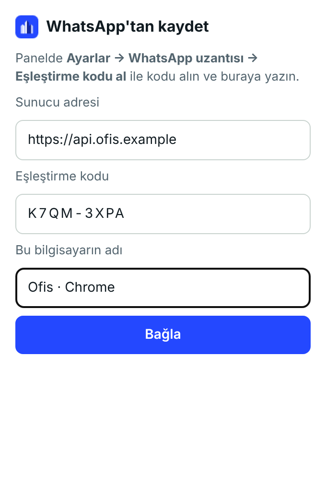
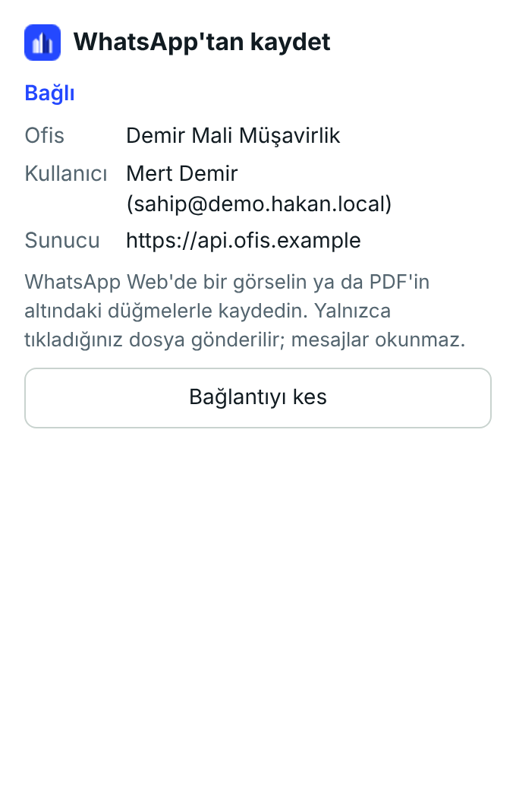

# WhatsApp Web uzantısı kılavuzu

> Mükelleften WhatsApp'la gelen fiş, fatura ve belgeleri tek tıkla gider, gelir ya da belge olarak kaydedin: kurulum, eşleştirme, kullanım ve gizlilik.

Uzantı Chrome ve Edge'de çalışır. WhatsApp Web'de gelen her görselin ve
PDF'in altına üç düğme ekler:

- **Gider olarak kaydet**: Fiş okunur ve onay bekleyen bir gider taslağı oluşur.
- **Gelir olarak kaydet**: Görsel Z raporu olarak okunur ve bir satış taslağı oluşur.
- **Belge olarak kaydet**: Dosya mükellefin açık belge talebine eklenir. Talep yoksa mükellefin belgesi olarak saklanır.

Gider ve gelir fotoğraftan okunur. PDF dosyalarda yalnızca **Belge olarak
kaydet** düğmesi görünür.

## Gizlilik

- Yalnızca düğmesine bastığınız dosya gönderilir.
- Mesajlar okunmaz ve hiçbir yere gönderilmez.
- Sunucuya giden bilgiler: dosya, dosyanın adı, sohbetin numarası ve
  sohbetin adı. Sohbetin adı, eşlemeler listesinde gösterilmek için gönderilir.
- Uzantı yalnızca `web.whatsapp.com` adresinde ve eşleştirmede yazdığınız
  sunucuda çalışır.

## Kurulum

Uzantı mağazada yayımlanmaz. Paket, yöneticinizin verdiği
`hakan-whatsapp-<sürüm>.zip` dosyasıdır.

1. Zip dosyasını bir klasöre açın (örneğin `Belgeler\hakan-whatsapp`).
   Uzantı bu klasörden çalışır; klasörü silmeyin.
2. Tarayıcıda uzantılar sayfasını açın:
   - Chrome için `chrome://extensions`
   - Edge için `edge://extensions`
3. **Geliştirici modu**nu açın.
4. **Paketlenmemiş öğe yükle**'ye tıklayın ve 1. adımda açtığınız klasörü seçin.
5. Araç çubuğundaki yapboz simgesinden **HAKAN · WhatsApp'tan kaydet**'i
   sabitleyin.

Yeni sürüm geldiğinde aynı klasörün içeriğini yeni zip'le değiştirin.
Ardından uzantılar sayfasında uzantının **Yeniden yükle** düğmesine basın.
Eşleştirme korunur.

## Eşleştirme

Uzantı ofis panelindeki hesabınızla çalışır; parola uzantıya yazılmaz.

1. Panelde **WhatsApp** sayfasını açın (kenar menüde **Ofis** altında).
2. **Eşleştirme kodu al**'a basın. Kod `XXXX-XXXX` biçimindedir, tek
   kullanımlıktır ve 10 dakika geçerlidir.
3. Araç çubuğunda HAKAN simgesine tıklayın ve şunları yazın:
   - **Sunucu adresi**: Panelde kodun altında görünür. Görünmüyorsa mobil
     uygulamanın kullandığı API adresidir; ofis yöneticinizden öğrenin.
   - **Eşleştirme kodu**: 2. adımda aldığınız kod.
   - **Bu bilgisayarın adı** (isteğe bağlı): Örneğin "Ofis · Chrome".
4. **Bağla**'ya basın. Tarayıcı sunucu adresine erişim izni ister; izin verin.

Bağlandıktan sonra pencerede ofis, kullanıcı ve sunucu görünür.

Uzantının oturumu, panelde **Hesap → Oturumlar** listesinde "HAKAN WhatsApp
Web uzantısı" adıyla görünür. Oturumu iki yerden kapatabilirsiniz: o
listeden ya da uzantı penceresindeki **Bağlantıyı kes** düğmesinden.

## Kullanım

1. WhatsApp Web'de mükellefin sohbetini açın.
2. Görselin ya da PDF'in altındaki düğmelerden birine basın.
3. Bu sohbetten ilk kez kayıt yapıyorsanız uzantı mükellefi sorar:
   - İletişim telefonu sohbet numarasıyla eşleşen mükellef üstte, "telefon
     eşleşti" etiketiyle görünür.
   - Başka bir mükellef için unvan ya da VKN / TCKN ile arayın.
   - **Bu sohbet için hatırla** işaretliyse, bu sohbetten sonraki kayıtlarda
     mükellef sorulmaz. Eşleme ofisteki herkes için geçerlidir.

   

4. Belge kaydederken mükellefin açık belge talebi varsa uzantı belgenin
   hangi talebe ait olduğunu sorar. **Talepsiz kaydet** ile talebe
   bağlamadan da kaydedebilirsiniz.
5. Sonuç ekranın altında bildirilir.

Aynı dosyayı aynı tür için ikinci kez kaydederseniz yeni kayıt açılmaz;
uzantı "bu dosya daha önce kaydedilmiş" der.

Görsel henüz indirilmediyse (bulanık görünüyorsa) önce görsele bir kez
tıklayın, sonra yeniden deneyin. Görseli tam ekran açtığınızda da
düğmeler üst çubukta görünür.

## Panelde

**WhatsApp** sayfasında üç bölüm vardır:

- **Uzantıyı bağla**: Eşleştirme kodu.
- **WhatsApp'tan kaydedilenler**: Uzantıyla yapılan bütün kayıtlar. Her
  kaydın mükellefi, türü, sonucu (taslak, mükerrer, talebe eklendi…) ve
  kaydedeni görünür. Talepsiz saklanan belgeler buradan indirilir.
- **Hatırlanan sohbetler**: Sohbet → mükellef eşlemeleri. Yanlış eşlemeyi
  **Eşlemeyi kaldır** ile silin; o sohbetten sonraki kayıtta mükellef
  yeniden sorulur.

Gider ve gelir taslakları her zamanki gibi inceleme kuyruğunda onaylanır.

Gereken yetki: kayıt için **fiş yükleme** (`tenant.receipts.write`). Belgeyi
bir belge talebine eklemek için **belge görevi yazma** yetkisi de gerekir.

## Sorun giderme

| Belirti | Ne yapmalı |
|---|---|
| Düğmeler görünmüyor | Sayfayı yenileyin. Uzantılar sayfasında uzantının açık olduğundan emin olun (sürüm 0.1.1 ya da üstü). WhatsApp Web güncellendiyse yöneticinize haber verin; uzantının yeni sürümü gerekebilir. Yöneticiniz isterse tanı özeti gönderin (aşağıya bakın). |
| "Sohbet ya da dosya tanınamadı" | Sohbeti kapatıp yeniden açın ve sayfayı yenileyin. Sürerse tanı özeti gönderin: WhatsApp'ın yeni sürümü sohbet kimliğini farklı bir yerde tutuyor olabilir. |
| "Belgenin indirme düğmesi bulunamadı" / belge inmiyor | Belgeye WhatsApp'ta bir kez tıklayıp indirin, sonra yeniden deneyin. Sürerse tanı özeti gönderin. |
| Tanı özeti nasıl alınır? | Uzantının deposundaki `extensions/whatsapp/scripts/tani.js` dosyasını yöneticinizden alın. WhatsApp Web'de içinde bir görsel ve bir PDF olan sohbeti açın, F12 ile geliştirici araçlarını açıp **Konsol** sekmesine betiğin tamamını yapıştırın ve Enter'a basın. Özet panoya kopyalanır. Betik mesaj metinlerini okumaz, numaraları maskeler; yalnızca sayfa yapısını ve sohbet kimliğinin türünü (`@c.us`, `@lid`, `@g.us`) yazar. |
| "Uzantı eşleştirilmemiş" | Panelden yeni kod alıp eşleştirin. |
| "Uzantının oturumu kapandı" | Oturum panelden kapatılmış ya da süresi dolmuş. Yeniden eşleştirin. |
| "Eşleştirme kodunun süresi dolmuş" | Kod 10 dakika geçerlidir ve bir kez kullanılır. Yeni kod alın. |
| "Gider ve gelir fotoğraftan okunur" | PDF'i **Belge olarak kaydet** ile kaydedin. |
| "Belge alınamadı" | PDF'i WhatsApp'tan indirin ve panelde mükellefin belge sayfasından yükleyin. |
| "Bu sohbet göremediğiniz bir mükellefe eşlenmiş" | Sohbet, size atanmamış bir mükellefe eşli. Ofis yöneticinize danışın. |
