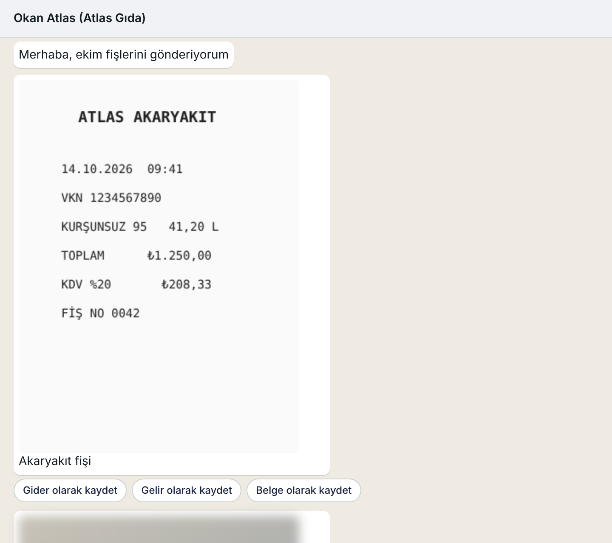
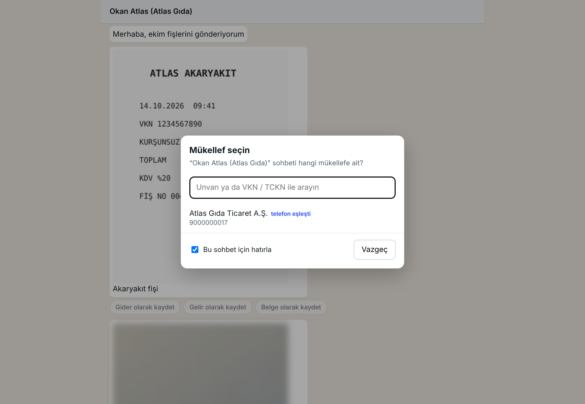
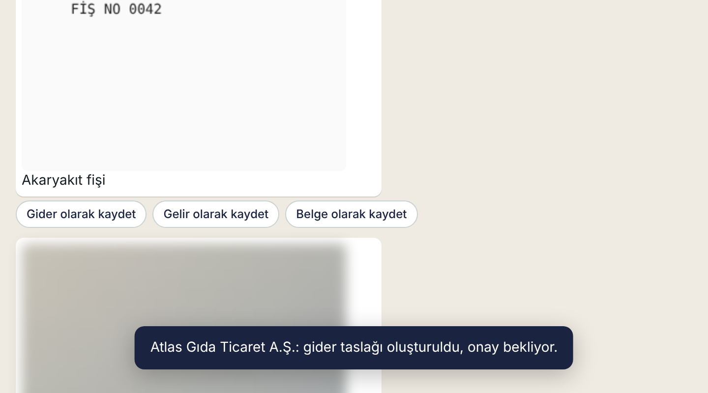

# WhatsApp Web uzantısı kılavuzu

> Mükelleften WhatsApp'la gelen fiş, fatura ve belgeleri tek tıkla gider, gelir ya da belge olarak kaydedin: kurulum, eşleştirme, kullanım ve gizlilik.

Uzantı Chrome ve Edge'de çalışır. WhatsApp Web'de gelen her görselin ve
PDF'in altına dört düğme ekler:

- **Gider olarak kaydet**: Fiş okunur ve onay bekleyen bir gider taslağı oluşur.
- **Gelir olarak kaydet**: Görsel Z raporu olarak okunur ve bir satış taslağı oluşur.
- **Belge olarak kaydet**: Dosya mükellefin açık belge talebine eklenir. Talep yoksa mükellefin belgesi olarak saklanır.
- **Yabancı fatura olarak kaydet**: Google Ads, AWS, yurt dışı yazılım lisansı gibi bir yurt dışı hizmet faturası, mükellefin **Yabancı faturalar / KDV2** sekmesine taslak olarak düşer. Fotoğrafsa satıcı, ülke, tutar ve döviz önerilir; ofis kontrol edip onaylar. Ofis yabancı faturaları ayarlardan kapattıysa kaydedilmez.

Gider ve gelir fotoğraftan okunur. PDF dosyalarda yalnızca **Belge olarak
kaydet** ve **Yabancı fatura olarak kaydet** düğmeleri görünür.

## Gizlilik

- Yalnızca düğmesine bastığınız dosya gönderilir.
- Mesajlar okunmaz ve hiçbir yere gönderilmez.
- Sunucuya giden bilgiler: dosya, dosyanın adı, sohbetin numarası ve
  sohbetin adı. Sohbetin adı, eşlemeler listesinde gösterilmek için gönderilir.
- Uzantı yalnızca `web.whatsapp.com` adresinde ve ofisinizin sunucusunda
  (pakete gömülü adres) çalışır.

## Kurulum (4 adım)

Panelde **WhatsApp** sayfasını açın (kenar menüde **Ofis** altında). Sayfanın
üstündeki kurulum kartı sizi adım adım götürür ve kaldığınız adımı hatırlar.
Kartın en üstünde uzantının durumu görünür: eşleşmemişse **Bekleniyor**,
eşleşince yeşil **Bağlandı ✓ (son görülme …)**.

### 1. İndir

1. **Uzantıyı indir**'e basın. `easytrade-whatsapp.zip` dosyası İndirilenler
   klasörüne iner. Düğmenin yanında paketin sürümü ve boyutu yazar.
2. Zip dosyasını bir klasöre çıkarın: Windows'ta sağ tıklayıp **Tümünü
   ayıkla**, Mac'te çift tıklayın. Uzantı bu klasörden çalışır; klasörü
   silmeyin.

Paket her zaman aynı adresten iner: `/indir/easytrade-whatsapp.zip`. Sunucu
adresi pakete gömülüdür; ayrıca yazmanız gerekmez.

### 2. Chrome'a ekle

1. Panelde `chrome://extensions` adresinin yanındaki **Kopyala**'ya basın.
   Yeni bir sekmede adres çubuğuna yapıştırıp Enter'a basın. Bu adres
   güvenlik nedeniyle bağlantı olarak açılamaz. Edge'de adres
   `edge://extensions`'tır.
2. Sağ üstteki **Geliştirici modu** anahtarını açın.
3. Sol üstte çıkan **Paketlenmemiş öğe yükle**'ye basın ve 1. adımda
   çıkardığınız klasörü seçin.
4. Araç çubuğundaki yapboz simgesine basın ve **Easytrade Müşavirim Ofis ·
   WhatsApp**'ı raptiyeyle sabitleyin.

### 3. Eşleştir

Uzantı ofis panelindeki hesabınızla çalışır; parola uzantıya yazılmaz.

1. Paneldeki kurulum kartında **3. Eşleştir**'e geçin ve **Eşleştirme kodu
   al**'a basın. Kod `XXXX-XXXX` biçimindedir, tek kullanımlıktır ve 10
   dakika geçerlidir.
2. Araç çubuğunda Easytrade simgesine tıklayın, kodu yazın ve **Eşleştir**'e
   basın. Tarayıcı sunucu adresine erişim izni ister; izin verin.

Eşleşince panelde durum yeşil **Bağlandı ✓** olur ve kart **4. Dene**
adımına geçer.

### 4. Dene

1. Uzantı penceresinde **Bağlantıyı test et**'e basın. Uzantı sunucuya
   ulaşabildiğini ve WhatsApp Web'in açık olduğunu denetler.
2. **WhatsApp Web'i aç** ile WhatsApp Web'i açın ve telefonunuzla giriş
   yapın.
3. Bir mükellef sohbetinde görselin altındaki düğmelerle kaydedin.

Uzantının oturumu, panelde **Hesap → Oturumlar** listesinde "HAKAN WhatsApp
Web uzantısı" adıyla görünür. Oturumu iki yerden kapatabilirsiniz: o
listeden ya da uzantı penceresindeki **Bağlantıyı kes** düğmesinden.

### Yeni sürüm

Panelden yeni zip'i indirin ve aynı klasörün içeriğini yenisiyle değiştirin.
Ardından uzantılar sayfasında uzantının **Yeniden yükle** düğmesine basın.
Eşleştirme korunur.

## Kullanım

1. WhatsApp Web'de mükellefin sohbetini açın.
2. Görselin ya da PDF'in altındaki düğmelerden birine basın.
3. Mükellef kendiliğinden bulunur: sohbetin numarası tek bir mükellefin
   iletişim telefonuyla eşleşiyorsa uzantı sormaz, bildirimde "Mükellef
   telefondan bulundu" yazar. Eşleşme yoksa (ya da birden çok mükellef aynı
   numarayı taşıyorsa) uzantı mükellefi sorar:
   - Numarası eşleşen mükellefler üstte, "telefon eşleşti" etiketiyle görünür.
   - Başka bir mükellef için unvan ya da VKN / TCKN ile arayın.
   - **Bu numarayı mükellefin telefonu olarak kaydet** (varsayılan işaretli):
     numara seçtiğiniz mükellefin iletişim telefonu olur, bir dahaki sefere
     sorulmaz. Değişiklik mükellefin etkinlik kaydına düşer. Grup
     sohbetlerinde bu kutu çıkmaz.
   - **Bu sohbet için hatırla** işaretliyse, bu sohbetten sonraki kayıtlarda
     mükellef sorulmaz. Eşleme ofisteki herkes için geçerlidir.

   

4. Belge kaydederken mükellefin açık belge talebi varsa uzantı belgenin
   hangi talebe ait olduğunu sorar. **Talepsiz kaydet** ile talebe
   bağlamadan da kaydedebilirsiniz.
5. Sonuç ekranın altında bildirilir.

### Durum rozeti

Kaydedilen fişin altında bir rozet durumu gösterir:

| Rozet | Anlamı |
| --- | --- |
| Okunuyor… | Fiş sunucuya gidiyor, okunuyor. |
| Kaydedildi · onay bekliyor | Taslak oluştu, ofiste onay bekliyor. |
| Onaylandı ✓ | Ofis onayladı. |
| Reddedildi | Ofis reddetti; nedenine panelden bakın. |
| Okunamadı | Fotoğraf okunamadı; panelde elle girin. |
| Mükerrer | Aynı fiş daha önce kayıtlı. |
| Kaydedildi | Belge ya da yabancı fatura saklandı. |

Rozet sohbeti yeniden açtığınızda da görünür (uzantı dosyayı tanır).
Onay bekleyen rozetler sekme açıkken kendiliğinden güncellenir.

Aynı dosyayı aynı tür için ikinci kez kaydetmek isterseniz hiçbir şey
gönderilmez; uzantı "Bu fiş zaten kaydedildi" der.

Görsel henüz indirilmediyse (bulanık görünüyorsa) önce görsele bir kez
tıklayın, sonra yeniden deneyin. Görseli tam ekran açtığınızda da
düğmeler üst çubukta görünür.

## Panelde

**WhatsApp** sayfasında üç bölüm vardır:

- **Kurulum**: 4 adımlı kurulum (İndir · Chrome'a ekle · Eşleştir · Dene), uzantının durumu ve eşleştirme kodu.
- **WhatsApp'tan kaydedilenler**: Uzantıyla yapılan bütün kayıtlar. Her
  kaydın mükellefi, türü, sonucu (taslak, mükerrer, talebe eklendi…) ve
  kaydedeni görünür. Talepsiz saklanan belgeler buradan indirilir.
- **Hatırlanan sohbetler**: Sohbet → mükellef eşlemeleri. Yanlış eşlemeyi
  **Eşlemeyi kaldır** ile silin; o sohbetten sonraki kayıtta mükellef
  yeniden sorulur.

Gider ve gelir taslakları her zamanki gibi inceleme kuyruğunda onaylanır.

Gereken yetki: kayıt için **fiş yükleme** (`tenant.receipts.write`). Belgeyi
bir belge talebine eklemek için **belge görevi yazma** yetkisi de gerekir.

## Sorun giderme

| Belirti | Ne yapmalı |
|---|---|
| Düğmeler görünmüyor | Sayfayı yenileyin. Uzantılar sayfasında uzantının açık olduğundan emin olun (sürüm 0.2.0 ya da üstü). WhatsApp Web güncellendiyse yöneticinize haber verin; uzantının yeni sürümü gerekebilir. Yöneticiniz isterse tanı özeti gönderin (aşağıya bakın). |
| "Sohbet ya da dosya tanınamadı" | Sohbeti kapatıp yeniden açın ve sayfayı yenileyin. Sürerse tanı özeti gönderin: WhatsApp'ın yeni sürümü sohbet kimliğini farklı bir yerde tutuyor olabilir. |
| "Belgenin indirme düğmesi bulunamadı" / belge inmiyor | Belgeye WhatsApp'ta bir kez tıklayıp indirin, sonra yeniden deneyin. Sürerse tanı özeti gönderin. |
| Tanı özeti nasıl alınır? | Uzantının deposundaki `extensions/whatsapp/scripts/tani.js` dosyasını yöneticinizden alın. WhatsApp Web'de içinde bir görsel ve bir PDF olan sohbeti açın, F12 ile geliştirici araçlarını açıp **Konsol** sekmesine betiğin tamamını yapıştırın ve Enter'a basın. Özet panoya kopyalanır. Betik mesaj metinlerini okumaz, numaraları maskeler; yalnızca sayfa yapısını ve sohbet kimliğinin türünü (`@c.us`, `@lid`, `@g.us`) yazar. |
| "Uzantı eşleştirilmemiş" | Panelden yeni kod alıp eşleştirin. |
| "Kod hatalı yazılmış" / "Kod 8 karakterdir" | Kodu paneldekiyle karşılaştırın. Kodda 0, O, 1, I ve L bulunmaz. |
| "Kod tutmadı" | Kod yanlış, süresi dolmuş (10 dakika) ya da daha önce kullanılmış. Panelden yeni kod alın. |
| "Sunucuya ulaşılamadı" | İnternet bağlantınızı kontrol edin; sürerse yöneticinize haber verin. |
| "Bu adreste Easytrade sunucusu yanıt vermedi" / "Sunucu adresi eksik" | Paketi paneldeki WhatsApp sayfasından yeniden indirip klasörün içeriğini değiştirin. |
| "Açık bir WhatsApp Web sekmesi yok" | Uzantıdaki **WhatsApp Web'i aç** ile açıp telefonunuzla giriş yapın. |
| Panelde durum "Bekleniyor" kalıyor | Eşleştirmeyi aynı hesapla yaptığınızdan emin olun. Durum birkaç saniyede bir yenilenir. |
| "Uzantının oturumu kapandı" | Oturum panelden kapatılmış ya da süresi dolmuş. Yeniden eşleştirin. |
| "Eşleştirme kodunun süresi dolmuş" | Kod 10 dakika geçerlidir ve bir kez kullanılır. Yeni kod alın. |
| "Gider ve gelir fotoğraftan okunur" | PDF'i **Belge olarak kaydet** ile kaydedin. |
| "Belge alınamadı" | PDF'i WhatsApp'tan indirin ve panelde mükellefin belge sayfasından yükleyin. |
| "Bu sohbet göremediğiniz bir mükellefe eşlenmiş" | Sohbet, size atanmamış bir mükellefe eşli. Ofis yöneticinize danışın. |
